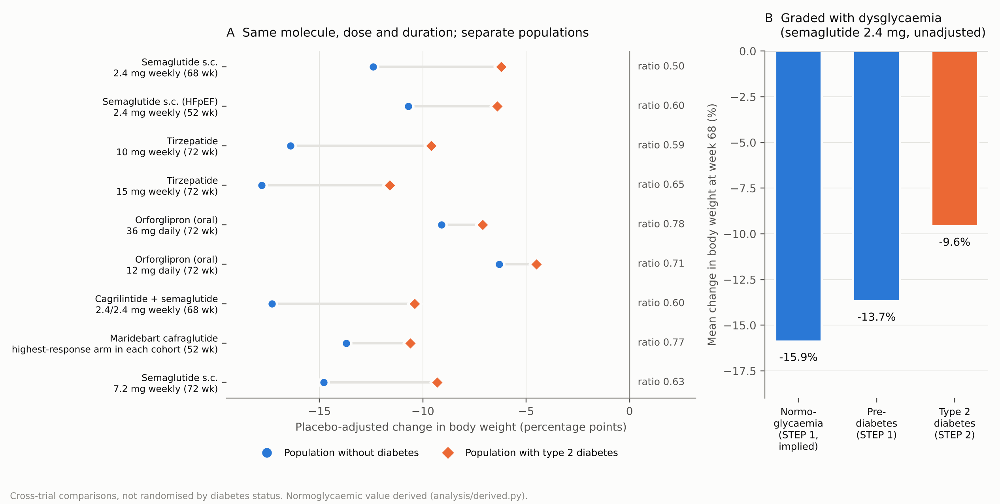
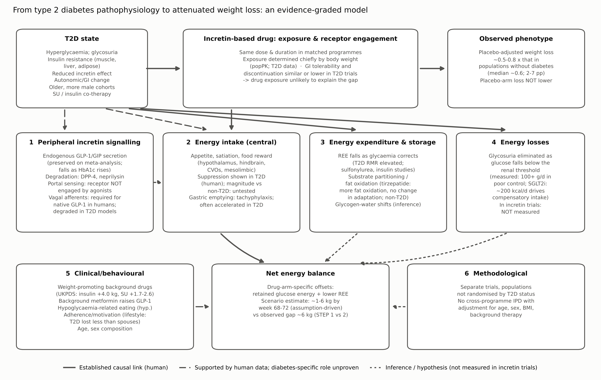

# Type 2 Diabetes and Attenuated Weight Loss During Incretin-Based Therapy: Mechanisms Linking Glucose Homeostasis to Energy Balance

*Narrative review informed by structured evidence retrieval. Draft for author review.*

## Abstract

Clinical trials of incretin-based therapies consistently report smaller reductions in body weight in people with type 2 diabetes (T2D) than in people without diabetes. We asked how robust that observation is and which mechanisms can account for it. We identified eight comparisons in which the same molecule, dose, treatment duration and estimand were tested in separate populations with and without T2D: semaglutide (two programmes), tirzepatide (two doses), orforglipron (two doses), cagrilintide–semaglutide and maridebart cafraglutide. In these comparisons the placebo-adjusted weight reduction in T2D was a median 0.62 (range 0.50–0.78) of that in populations without diabetes, an absolute difference of 2–7 percentage points. A prespecified pooled analysis of harmonised semaglutide heart-failure trials confirmed strong heterogeneity between the diabetes and non-diabetes populations (I² ≈ 96%). The deficit is graded across normoglycaemia, prediabetes and T2D, and it appears across agents with different receptor profiles. Placebo-arm weight change is not smaller in T2D, which places the deficit in the drug-attributable effect. Human studies show that incretin agonists suppress appetite in T2D, but no study has compared the magnitude of that suppression with that in people without diabetes. The peripheral apparatus around the receptor — endogenous secretion, degradation, and vagal afferent transmission — is measurably altered in T2D, and intact vagal innervation is required for native GLP-1 to suppress intake in humans; but incretin secretion is on average preserved and falls only with worsening glycaemic control, the portal afferent receptor appears not to be engaged by exogenous agonists, and prolonging native GLP-1 pharmacologically does not reduce weight. Correction of hyperglycaemia removes urinary glucose energy losses and lowers resting energy expenditure. Calculations based on measured inputs suggest these offsets could account for roughly 1–6 kg by 68–72 weeks, but neither has been measured in an incretin trial. Co-prescribed weight-promoting drugs, differences in age and sex, and behavioural factors probably contribute. Evidence for an intrinsic, insulin-resistance-driven resistance to incretin pharmacology is weak. The most important missing evidence is an energy-balance study, under matched conditions, that measures intake, expenditure and urinary energy losses in people with and without T2D receiving the same agent.

**Keywords:** incretin; GLP-1 receptor agonist; tirzepatide; semaglutide; type 2 diabetes; obesity; energy balance; glycosuria; vagal afferent; autonomic neuropathy

## 1. Introduction

Medicines that act on the glucagon-like peptide-1 (GLP-1) receptor were first developed to lower glucose. They amplify glucose-dependent insulin secretion and suppress glucagon. They later proved to be the most effective drug treatments for obesity, and newer molecules add activity at the glucose-dependent insulinotropic polypeptide (GIP), glucagon or amylin receptors [1,2]. The same drugs are therefore used for two related but distinct goals: correcting dysglycaemia and reducing adiposity.

A consistent observation accompanies this dual use. When one molecule is studied at the same dose and for the same duration in separate trials of people with and without T2D, the trials in T2D report smaller weight reductions. For semaglutide 2.4 mg the placebo-adjusted reduction at 68 weeks was 12.4 percentage points without diabetes [3] and 6.2 points with T2D [4]. Similar differences appear with tirzepatide [5,6], with the oral small-molecule agonist orforglipron [7,8] and with cagrilintide–semaglutide [9,10].

The difference matters clinically, because weight reduction of this size changes glycaemic, cardiovascular and functional outcomes in T2D, and smaller responses shape both expectations and choice of agent. It is also informative mechanistically. Glucose lowering and weight reduction are separate pharmacological outputs. Correcting hyperglycaemia depends mainly on islet effects, whereas weight reduction depends on a sustained negative energy balance. The mechanisms that correct dysglycaemia need not determine weight loss, and correcting dysglycaemia can itself change energy balance.

This review addresses two questions separately. The clinical question is how confidently we can conclude that T2D is associated with less weight loss on comparable incretin-based therapy, and how large the difference is. The mechanistic question is which physiological or pharmacological processes could explain the difference, and which have actually been shown to do so. We consider four classes of explanation: (1) direct modification by T2D of the response to receptor agonism, whether centrally or through the peripheral secretory, degradative and afferent machinery that surrounds the receptor; (2) indirect metabolic effects of glycaemic correction on energy balance; (3) clinical and behavioural factors, including co-prescribed medicines; and (4) methodological artefacts arising from comparisons between trials. Throughout, we distinguish established causal links, supportive human evidence, indirect inference and hypotheses.

The evidence was assembled through structured searches of PubMed/MEDLINE and ClinicalTrials.gov, with backward citation tracking from pivotal trials. Every quantitative claim was checked against the primary abstract or, where accessible, the full text. This is a narrative review; it is not a systematic review and makes no claim of exhaustive screening (see Supplementary Methods and the quality-control report).

## 2. Clinical evidence: is weight loss attenuated in T2D?

### 2.1 What kind of comparison can answer the question?

Three kinds of evidence bear on the question, and they differ in strength. The strongest would be a randomised trial that stratifies by diabetes status and formally tests whether the treatment effect differs between strata (effect modification). No such trial has been designed for weight as its primary question. The next best are comparisons in which one protocol, or harmonised protocols, enrolled both populations, ideally analysed together from individual participant data (IPD). Weakest, but most plentiful, are comparisons of separate trials of the same molecule, dose, duration and estimand within one development programme. Comparisons of mean weight change between unrelated trials cannot distinguish an effect of diabetes from differences in population, background therapy or trial conduct. They also cannot show that individual patients respond differently, as opposed to populations differing on average.

### 2.2 Matched programmes

Table 1 summarises the matched comparisons, and Figure 1A shows them graphically. All use treatment-policy or treatment-regimen estimands, which count outcomes regardless of discontinuation, so the comparisons are not distorted by differences in persistence.

For semaglutide 2.4 mg weekly over 68 weeks, STEP 1 (no diabetes; baseline weight 105.3 kg, BMI 37.9 kg/m², HbA1c 5.7%) reported −14.9% versus −2.4% with placebo, an estimated treatment difference (ETD) of −12.4 percentage points [3]. STEP 2 (T2D; HbA1c 7–10%) reported −9.6% versus −3.4%, an ETD of −6.2 points [4]. For tirzepatide over 72 weeks, SURMOUNT-1 (no diabetes) reported −19.5% at 10 mg and −20.9% at 15 mg versus −3.1% with placebo [5]. SURMOUNT-2 (T2D; mean HbA1c 8.02%, diabetes duration 8.5 years) reported −12.8% and −14.7% versus −3.2% [6]. For orforglipron 36 mg over 72 weeks the results were −11.2% versus −2.1% without diabetes [7] and −9.6% versus −2.5% with T2D [8]. For cagrilintide–semaglutide over 68 weeks they were −20.4% versus −3.0% (ETD −17.3) [9] and −13.7% versus −3.4% (ETD −10.4) [10]. Liraglutide 3.0 mg showed the same direction: a placebo-adjusted −5.6 kg without diabetes [11] and −4.2 kg with T2D [12], from similar baseline weights (about 106 kg).

Several other programmes point the same way but cannot be matched as cleanly. With retatrutide, a GIP/GLP-1/glucagon receptor tri-agonist, phase 2 weight loss reached 24.2% at 48 weeks in obesity [13] and 16.9% at 36 weeks in T2D [14]. The durations differ, so the comparison is only qualitative. Oral semaglutide 50 mg produced a 15.1% reduction (ETD −12.7) in people without diabetes [15]. The corresponding T2D trial of 25 and 50 mg had no placebo arm [16]. In the SURPASS and SUSTAIN programmes in T2D, doses were chosen for glycaemic control and comparators were active. Weight reductions were 7.0–9.5 kg with tirzepatide monotherapy over 40 weeks [17], 1.9–5.5 kg greater with tirzepatide than with semaglutide 1 mg [18], and only 0.9 kg greater with semaglutide 2.0 mg than with 1.0 mg [19]. These T2D trials show that weight response rises with dose and potency in diabetes. They do not provide a matched comparator without diabetes.

Across the eight percentage-based comparisons, the placebo-adjusted reduction in T2D was a median 0.62 times that without diabetes (range 0.50–0.78). The absolute deficit was a median 5.2 percentage points (range 1.8–6.9) (Table 1; analysis/derived.py). Two features stand out. First, the ratio is broadly similar for selective GLP-1 receptor agonists, the GIP/GLP-1 co-agonist tirzepatide and the amylin–GLP-1 combination. Second, placebo-arm weight change was not smaller in T2D (−3.4% vs −2.4% for semaglutide; −3.2% vs −3.1% for tirzepatide; −2.5% vs −2.1% for orforglipron; −3.4% vs −3.0% for cagrilintide–semaglutide). The deficit therefore lies in the drug-attributable component rather than in the response to the lifestyle programme delivered to both arms.

### 2.3 Harmonised and single-protocol evidence

The STEP-HFpEF programme provides the closest available approach to a direct test. Two trials with harmonised eligibility criteria, endpoints and analyses enrolled people with obesity-related heart failure with preserved ejection fraction, one without diabetes and one with T2D. Both gave semaglutide 2.4 mg for 52 weeks. Weight change was −13.3% versus −2.6% without diabetes (ETD −10.7) [20] and −9.8% versus −3.4% with T2D (ETD −6.4) [21]. The prespecified IPD pooled analysis found substantial heterogeneity between the trials for weight (p<0.0001; I² 95.8%), whereas improvements in heart-failure symptoms were consistent [22]. The authors note roughly 40% less weight loss with diabetes. Even here, diabetes status was not randomised, and the trials differed in recruitment and background therapy.

The phase 2 trial of maridebart cafraglutide, which combines GLP-1 receptor agonism with GIP receptor antagonism, enrolled an obesity cohort and an obesity-with-T2D cohort under one protocol [23]. At 52 weeks, weight change ranged from −12.3% to −16.2% (placebo −2.5%) in the obesity cohort and from −8.4% to −12.3% (placebo −1.7%) in the T2D cohort. The dosing arms were not identical between cohorts, and the T2D cohort was older (55.1 vs 47.9 years) and included fewer women (42% vs 63%).

Observational data point the same way. In a referral-centre cohort treated with semaglutide 1.7–2.4 mg, people with T2D lost 7.2% versus 11.8% at 6 months [24]. In a large propensity-matched electronic-record cohort, people without T2D lost more weight than people with T2D on both tirzepatide and semaglutide. The authors explicitly raise differences in motivation and concurrent weight-loss activity as possible explanations [25].

### 2.4 A gradient with dysglycaemia

In a post hoc analysis of STEP 1, participants with prediabetes lost 13.7% with semaglutide (ETD −11.3) [26], compared with 14.9% in the whole semaglutide arm [3]. Assuming the overall mean is the weighted average of the subgroup means, normoglycaemic participants lost about 15.9%. Normoglycaemia (~15.9%), prediabetes (13.7%) and T2D (9.6%) therefore form a graded series on the same dose and duration (Figure 1B). The gradient is unadjusted and comes from different trials, so it does not establish dose–response causation. It does argue against a threshold effect confined to overt diabetes. Its presence in prediabetes, where glycosuria is negligible, also limits how much of the gap any glycosuria-based explanation alone can carry (Section 9). In SURMOUNT-1, participants with prediabetes still lost 18.7–19.7% with tirzepatide 10–15 mg over 176 weeks [27], so large responses remain achievable in dysglycaemia.

### 2.5 Could the difference be an artefact?

Several features of the trials argue against a purely methodological explanation.

* **Dose, duration and estimand** were matched within each programme.
* **Discontinuation and tolerability** do not favour the trials without diabetes. Gastrointestinal adverse events were reported by 72.5% in REDEFINE 2 versus 79.6% in REDEFINE 1 [9,10]. Discontinuations for adverse events were similar in ATTAIN-1 and ATTAIN-2 (5.3–10.3% vs 6.1–9.9%) [7,8].
* **Analyses that remove discontinuation** leave the difference in place. Under the efficacy estimand, which estimates the effect had treatment continued as intended, SURMOUNT-2 reported ETDs of −10.1 and −12.4 points [6]. These remain well below the treatment-regimen ETDs of −16.4 and −17.8 points in SURMOUNT-1 [5], although the treatment-regimen estimand includes the effect of discontinuation and so understates the drug's full on-treatment effect.
* **Drug exposure** is unlikely to explain the difference. Within T2D programmes, population pharmacokinetic analyses identify body weight as the only clinically relevant covariate of semaglutide exposure [28], and weight and HbA1c responses track plasma exposure [29]. Baseline body weights in the matched programmes were similar. An exposure–response model of semaglutide spanning populations with and without T2D used baseline HbA1c as a covariate [30], but we could not verify from the accessible text how much it changed the predicted response.

Other differences do favour the trials without diabetes. The T2D trials enrol older participants with a higher proportion of men. Women lost more weight in the STEP-HFpEF pool [22]; STEP 1 enrolled 74.1% women and SURMOUNT-2 50.7% [3,6]. T2D participants also continued glucose-lowering drugs, including sulfonylureas in 26.7% of SURMOUNT-2 participants [6]. No analysis has pooled IPD across programmes with adjustment for age, sex, baseline BMI, HbA1c, diabetes duration and background therapy. Without one, the share of the gap attributable to these population differences cannot be quantified.

### 2.6 What the clinical evidence establishes

The clinical phenotype is robust. It appears in every matched programme, in harmonised IPD, in a single-protocol trial and in observational cohorts, and it is graded with glycaemic status. On average, people with T2D achieve about 50–80% (median ~60%) of the placebo-adjusted weight reduction seen without diabetes. The absolute shortfall is about 2–7 percentage points at 52–72 weeks, larger with the most potent agents. Because the deficit occurs in the drug-attributable component, and across GLP-1 receptor agonists, GIP receptor agonism and antagonism, amylin co-agonism and lifestyle intervention [31], it is more likely to reflect host physiology and context than a defect specific to one receptor. What the evidence cannot yet establish is how much of the population difference is effect modification by diabetes itself rather than confounding by co-varying traits.

**Table 1. Matched comparisons of incretin-based therapies in populations with and without T2D.** Values are mean % change in body weight from baseline to end of treatment (drug vs placebo). ETD = estimated treatment difference (percentage points). TP = treatment-policy estimand; TR = treatment-regimen estimand.

| Agent and dose | Weeks | Population without diabetes (trial; key baseline) | Drug vs placebo; ETD | Population with T2D (trial; key baseline; background therapy) | Drug vs placebo; ETD | Ratio T2D/no-T2D (ETD) |
|---|---|---|---|---|---|---|
| Semaglutide 2.4 mg weekly | 68 | STEP 1, n=1961; 105.3 kg, BMI 37.9, HbA1c 5.7%, 74% women [3] | −14.9 vs −2.4; −12.4 (−13.4 to −11.5), TP | STEP 2, n=1210; HbA1c 7–10%; 0–3 oral agents [4] | −9.6 vs −3.4; −6.2 (−7.3 to −5.2), TP | 0.50 |
| Semaglutide 2.4 mg weekly (HFpEF) | 52 | STEP-HFpEF, n=529 [20] | −13.3 vs −2.6; −10.7 (−11.9 to −9.4) | STEP-HFpEF DM, n=616; HbA1c ≤10% [21] | −9.8 vs −3.4; −6.4 (−7.6 to −5.2) | 0.60 (IPD heterogeneity p<0.0001) [22] |
| Tirzepatide 10 mg weekly | 72 | SURMOUNT-1, n=2539; 104.8 kg, BMI 38.0 [5] | −19.5 vs −3.1; −16.4*, TR | SURMOUNT-2, n=938; 100.7 kg, BMI 36.1, HbA1c 8.02%, duration 8.5 y; metformin 89%, SU 27%, SGLT2i 20% [6] | −12.8 vs −3.2; −9.6 (−11.1 to −8.1), TR | 0.59 |
| Tirzepatide 15 mg weekly | 72 | SURMOUNT-1 [5] | −20.9 vs −3.1; −17.8*, TR | SURMOUNT-2 [6] | −14.7 vs −3.2; −11.6 (−13.0 to −10.1), TR | 0.65 |
| Orforglipron 36 mg daily (oral) | 72 | ATTAIN-1, n=3127 [7] | −11.2 vs −2.1; −9.1*, TR | ATTAIN-2, n=1613; 101.4 kg, BMI 35.6, HbA1c 8.05% [8] | −9.6 vs −2.5; −7.1 (−8.2 to −6.1), TR | 0.78 |
| Orforglipron 12 mg daily (oral) | 72 | ATTAIN-1 [7] | −8.4 vs −2.1; −6.3*, TR | ATTAIN-2 [8] | −7.0 vs −2.5; −4.5, TR | 0.71 |
| Cagrilintide 2.4 mg + semaglutide 2.4 mg weekly | 68 | REDEFINE 1, n=3417 [9] | −20.4 vs −3.0; −17.3 (−18.1 to −16.6), TP | REDEFINE 2, n=1206; HbA1c 7–10% [10] | −13.7 vs −3.4; −10.4 (−11.2 to −9.5), TP | 0.60 |
| Maridebart cafraglutide (highest-response arm) | 52 | Obesity cohort, n=465; BMI 37.9, 63% women [23] | −16.2 vs −2.5; −13.7*, TP | Obesity–T2D cohort, n=127; BMI 36.5, 42% women [23] | −12.3 vs −1.7; −10.6*, TP | 0.77 (dose arms differ) |
| Liraglutide 3.0 mg daily | 56 | SCALE Obesity & Prediabetes, n=3731; 106.2 kg [11] | −8.4 vs −2.8 kg; −5.6 kg | SCALE Diabetes, n=846; 0–3 oral agents [12] | −6.0% (−6.4 kg) vs −2.0% (−2.2 kg); −4.0 (−5.1 to −2.9) | 0.75 (kg basis) |

*ETD calculated as drug minus placebo from published means; confidence interval not reported in the abstract. SU, sulfonylurea; SGLT2i, sodium–glucose co-transporter 2 inhibitor. Ratios computed in analysis/derived.py.

## 3. Incretin pharmacology: separating glucose lowering from weight loss

### 3.1 Endogenous physiology versus pharmacology

Endogenous GLP-1 and GIP are short-lived peptides secreted after meals. Both potentiate glucose-stimulated insulin secretion. GLP-1 also suppresses glucagon, slows gastric emptying and reduces food intake [1]. In T2D the incretin effect, the extra insulin secreted after oral compared with intravenous glucose at matched glycaemia, is markedly reduced: incretin factors accounted for 36% of the insulin response in T2D versus 73% in matched controls [32]. The defect is largely a consequence of the diabetic state rather than its cause. It appears in diabetes secondary to chronic pancreatitis but not in pancreatitis with normal glucose tolerance [33]. Four weeks of near-normoglycaemia improved the late-phase β-cell response to GLP-1 and GIP three- to fourfold [34].

These findings concern the endocrine pancreas at physiological hormone concentrations. They do not imply reduced responsiveness to long-acting agonists at pharmacological exposures. Infused GLP-1 retained most of its insulinotropic activity in mild T2D, whereas the insulinotropic effect of GIP was reduced by 54% [35]. GIP also failed to amplify late-phase secretion [36]. Graded GLP-1 infusions increased β-cell glucose responsiveness in T2D, but at each dose the response was 3–5 times smaller than in controls. Even so, a low dose restored responsiveness to the level of untreated controls [37]. A reduced physiological incretin effect is therefore a statement about the islet. It says nothing direct about the brain and gut circuits through which agonists reduce energy intake.

### 3.2 Two outputs, partly separate pathways

The glucose-lowering effects of incretin drugs arise mainly from islet mechanisms (insulin secretion and glucagon suppression), from slower gastric emptying of meal glucose, and secondarily from weight reduction and improved insulin sensitivity. In a mechanistic study in T2D, tirzepatide improved the clamp disposition index, total insulin secretion, insulin sensitivity (M value) and glucagon suppression more than semaglutide 1 mg [38]. Weight reduction, by contrast, depends on a sustained negative energy balance. That balance is driven mainly by reduced energy intake, with little or no increase in energy expenditure in humans (Sections 4 and 10). Both outputs share the receptor but not the effector organs. This is why a drug can improve glycaemia without changing weight, as low-dose liraglutide (0.6 mg) did in an 8-week respiratory-chamber study in T2D [39], and why glycaemic correction can feed back on energy balance (Section 9).

### 3.3 Exposure, receptor engagement and molecular class

Long-acting peptide agonists achieve sustained plasma concentrations far above endogenous GLP-1. Within T2D, semaglutide exposure varies mainly with body weight [28]. Oral and subcutaneous formulations show nearly identical exposure–response relationships for HbA1c and body weight, which suggests that variation between individuals in GLP-1 receptor responsiveness is not a major determinant of response [29]. Agents differ in other ways. Tirzepatide engages the GIP receptor more than the GLP-1 receptor at clinical doses, and at the GLP-1 receptor it favours cAMP signalling over β-arrestin recruitment and causes less receptor internalisation [40]. Orforglipron is a non-peptide oral agonist [7]. Cagrilintide adds amylin receptor agonism [9]. Maridebart cafraglutide pairs GLP-1 agonism with GIP receptor antagonism [23]. Despite these differences, the attenuation ratio in T2D is similar across agents (Table 1). That similarity is the first indication that the explanation lies mainly in the host rather than in a receptor-specific pharmacodynamic defect.

## 4. Central regulation of appetite and energy intake

### 4.1 How incretin agonists reduce intake

Reduced energy intake is the dominant driver of incretin-induced weight loss. In adults with obesity, semaglutide 1.0 mg reduced ad libitum energy intake across a test day by 24%, with less hunger and food craving, better control of eating and a lower preference for high-fat foods. Resting metabolic rate adjusted for lean mass did not change [41]. Semaglutide 2.4 mg reduced ad libitum lunch intake by 35% after 20 weeks [42]. Tirzepatide reduced intake at an ad libitum lunch by about 525 kcal at week 3 in adults without diabetes. It also reduced food cravings, the tendency to overeat and responsiveness to food cues, and reduced activation to high-fat, high-sugar food images in orbitofrontal, cingulate and hippocampal regions [43]. In humans, GLP-1 receptors have been identified on neurons of the hypothalamus, medulla and parietal cortex [44].

Animal studies define the circuitry. Peripherally administered semaglutide does not cross the blood–brain barrier. It reaches circumventricular organs and periventricular sites, activates hindbrain and hypothalamic neurons, and engages secondary nodes such as the lateral parabrachial nucleus. In rodents it reduces intake without lowering energy expenditure [45]. Liraglutide directly activates arcuate POMC/CART neurons and indirectly inhibits NPY/AgRP neurons through GABAergic transmission. Its weight-lowering effect persisted after loss of GLP-1 receptors in vagal afferents, area postrema or paraventricular nucleus [46]. Other work shows that vagal afferent and central receptor populations both contribute, because vagal deafferentation shifts the dose–response curve [47]. The pharmacological effect is also separable from the endogenous brainstem preproglucagon system. Those neurons are the predominant source of GLP-1 within the brain, but their ablation left ad libitum intake, body weight and glucose tolerance unchanged in mice, affecting intake only after a prolonged fast or a liquid preload and abolishing stress-induced hypophagia — a secondary satiation circuit rather than a primary regulator [48] — and they are not required for the anorexia induced by GLP-1 receptor agonists [49]. These rodent data describe pathways. They do not show that any pathway behaves differently in human T2D. The peripheral limb of the same circuitry, including vagal afferent transmission and the endogenous incretin background on which the drug is superimposed, is considered separately in Section 5.

### 4.2 Appetite suppression in T2D: present, magnitude untested

Three types of evidence should be kept apart.

**Incretin agonism suppresses appetite in T2D.** This is well supported. Intravenous GLP-1 reduced energy intake by 27% in T2D [50]. Liraglutide 1.8 mg reduced ad libitum intake by 18% after 3 weeks [51]. Tirzepatide and semaglutide both reduced appetite in T2D over 28 weeks [52]. In a crossover fMRI study, exenatide reduced food intake and food-cue responses in insula, amygdala, putamen and orbitofrontal cortex in obese people with T2D as well as in normoglycaemic obese people, and receptor blockade with exendin 9-39 largely prevented these effects [53]. In T2D, liraglutide reduced insula and putamen responses to food pictures after 10 days but not after 12 weeks, relative to insulin glargine [54]. It also reduced parietal activation to highly desirable foods [44].

**Whether appetite suppression is smaller in T2D** is unknown. No study has compared ad libitum intake, appetite ratings or food-cue responses between people with and without diabetes receiving the same agonist under identical conditions. Apparent differences between studies, such as 27% with GLP-1 infusion in T2D versus 12% in healthy men [55], reflect different infusion rates, meals and populations and cannot be interpreted as effect modification.

**Whether a difference in appetite suppression explains the weight-loss gap** has therefore never been tested. One observation is suggestive. In T2D, tirzepatide produced more weight loss than semaglutide 1 mg, but intake at an ad libitum lunch did not differ between the drugs. The authors concluded that measured intake did not account for the difference in weight outcome [52]. A single test meal is an insensitive measure of 24-hour intake, so this finding should not be overinterpreted.

### 4.3 Could the diabetic state blunt central responses?

Several plausible mechanisms exist, but none has been linked to incretin response. In adults with obesity, MRI markers of mediobasal hypothalamic gliosis were greater in impaired glucose tolerance and T2D than in normal glucose tolerance, independent of adiposity. They correlated with glycaemia and insulin resistance [56]. Brain insulin resistance in obesity and T2D alters eating behaviour and reward processing [57]. In obese T2D and normoglycaemic obese participants, food-cue responses in appetite and reward regions were greater than in lean participants [53]. A larger baseline drive to eat would oppose a given pharmacological suppression. Whether gliosis, central insulin resistance or heightened food-cue reactivity reduces the *magnitude* of GLP-1-induced anorexia in T2D has not been studied. These remain hypotheses.

### 4.4 Compensatory regulation

Weight loss provokes compensatory increases in appetite. In patients treated with canagliflozin, whose energy deficit comes from glycosuria without appetite suppression, calculated energy intake rose by about 100 kcal/day for each kilogram lost. That is more than three times the accompanying adaptation in energy expenditure [58]. A common interpretation, not directly tested in humans, is that incretin agonists shift the level at which this feedback operates. Under that model, any additional, drug-independent energy inflow in T2D, such as glucose energy previously lost in urine (Section 9), would act on this feedback system and lead to a higher weight plateau.

## 5. Peripheral incretin signalling: the endogenous background, its degradation and afferent transmission

Section 4 considered the brain. This section considers everything upstream of it: the endogenous incretin secreted by the gut, the enzymes that destroy it, the receptors it meets in the gut wall and hepatoportal bed, and the afferent nerves that carry the resulting signal. Each of these is altered in T2D. Whether any of it changes how a pharmacological agonist performs is a separate question, and the answer turns on a single issue of pharmacology that we take first.

### 5.1 Why the endogenous background might matter at all

A long-acting agonist does not need endogenous GLP-1 to activate the GLP-1 receptor. It reaches sustained plasma concentrations far above physiological ones (Section 3.3), and it is engineered to resist the enzymatic degradation that limits the native peptide [59]. On the simplest reading, the state of the endogenous system is therefore irrelevant to drug effect, and reduced native secretion in T2D would predict a *larger* relative response to an agonist, not a smaller one.

Two considerations complicate that reading. First, endogenous GLP-1 acts substantially where it is released. Native GLP-1 has a circulating half-life of minutes, and a large fraction of an intravenous bolus is inactivated before it leaves the portal circulation [60,61]. Much of its physiological action is therefore paracrine and neural, exerted on receptors in the gut wall and hepatoportal bed before the peptide reaches the systemic circulation at all [60]. A drug delivered subcutaneously arrives at those same receptors from the systemic side, at different concentrations and without the postprandial timing. Second, the pathway that carries the signal onward — vagal afferent fibres and their brainstem targets — is itself a structure that diabetes damages (Section 5.5). If the drug's effect depends partly on that pathway, then degrading the pathway could degrade the drug effect regardless of receptor occupancy.

The peripheral hypothesis, then, is not that T2D leaves too little endogenous GLP-1 for the drug to work with. It is that T2D may erode a paracrine and neural substrate on which part of the agonist's anorectic effect depends, and may remove a physiological signal that normally works alongside it.

### 5.2 Endogenous GLP-1 and GIP secretion in T2D: contested, and graded with glycaemia

Individual studies support reduced GLP-1 secretion in T2D. In 54 patients with T2D compared with 33 controls with normal glucose tolerance, the 4-hour meal GLP-1 response was lower (area under the curve 2482 ± 145 versus 3101 ± 198 pmol/L × 240 min; p = 0.024), and a model including diabetes, BMI, male sex and other terms explained 42% of the variance in that response [62]. In a meal study of eight obese patients with T2D against eight matched obese healthy participants, GLP-1 responses were reduced in T2D while GIP responses were normal [63].

Systematic evidence qualifies this substantially. A meta-analysis of 22 trials and 29 stimulation tests (275 patients with T2D, 279 controls) found *no* significant difference in total GLP-1 responses by any measure — peak concentration, total or incremental area under the curve, or their time-corrected equivalents [64]. A companion meta-analysis of 23 trials found GIP secretion likewise preserved [65]. The authors concluded that patients with T2D do not in general show reduced incretin secretion.

The qualification that survives is the one that matters most here. In both meta-analyses, meta-regression showed that HbA1c and fasting plasma glucose predicted the incremental GLP-1 response, and HbA1c predicted GIP responses negatively [64,65]. Reduced secretion is thus not a property of having diabetes but a function of how poorly controlled it is. This matters for two reasons. It means a uniform secretory deficit cannot be assumed in trial populations, whose mean HbA1c was around 8% (Table 1). And it predicts a graded rather than threshold relationship, which is the shape the clinical phenotype actually has (Section 2.4). The same logic applies at the islet: near-normalisation of glycaemia for four weeks improved the β-cell response to both GLP-1 and GIP three- to fourfold [34], and in rat islets chronic hyperglycaemia reduced GLP-1 and GIP receptor expression reversibly [66].

### 5.3 Degradation: DPP-4 and neprilysin

Dipeptidyl peptidase-4 (DPP-4) cleaves GLP-1(7–36) amide to an inactive form and is expressed on endothelium throughout the portal and systemic circulation [60]. Higher DPP-4 activity would lower the active fraction of endogenous GLP-1 reaching paracrine and portal receptors — a second reduction compounding any secretory deficit.

The human evidence is weaker than it is often presented. In 985 people with newly diagnosed T2D, plasma DPP-4 activity correlated positively with HbA1c and HOMA-IR, and those in the highest activity quartile had worse metabolic profiles [67]. This is a cross-sectional association within T2D; it does not establish that activity is higher than in people without diabetes. A 12-week exercise and weight-loss intervention in 14 older adults with metabolic syndrome lowered plasma DPP-4 by 10%, and the fall correlated with improved clamp-derived insulin sensitivity (r = −0.59) [68] — an intervention study with no non-diabetic comparator, n = 14, and no measurement of GLP-1 or body weight. Neither study supports a quantitative claim about how much active GLP-1 is lost.

Two mechanistic observations are nonetheless informative about *where* degradation matters. In mice, blood-glucose lowering after the DPP-4 inhibitor anagliptin correlated with small-intestinal DPP-4 inhibition (r = 0.949) but not with plasma DPP-4 inhibition, in both normal and diabetic models, with intact GLP-1 rising in the portal circulation [69]. And neprilysin, upregulated in obesity and T2D, also degrades GLP-1: high-fat-fed neprilysin-deficient mice had higher active GLP-1 (5.8 ± 1.1 versus 3.5 ± 0.8 pmol/L), lower plasma DPP-4 activity and better glucose tolerance [70]. Both findings locate the degradative bottleneck in the gut and portal bed rather than the systemic circulation. Both are rodent studies, and the neprilysin result is a genetic deletion, not pharmacological inhibition.

The clinical counterpoint is decisive for the drug question. DPP-4 inhibitors raise endogenous active GLP-1 and improve glycaemia, yet produce negligible weight loss. Prolonging the residence of native GLP-1 is therefore not sufficient to reduce body weight, which bounds how much any degradation-based mechanism can contribute to a weight-loss deficit.

### 5.4 Where peripheral GLP-1 acts: paracrine vagal afferents, not the hepatoportal route

GLP-1 receptors are expressed on vagal afferent neurons of the nodose ganglion, which project to the nucleus tractus solitarii and onward to hypothalamic feeding centres [47,61]. Three lines of animal work define the anatomy more precisely, and they do not all point the same way.

**A portal glucose sensor exists and is GLP-1-receptor-dependent.** Low-rate intragastric glucose in mice increased muscle glycogen synthesis by 30% and induced c-Fos in brainstem and hypothalamus, colocalising with arcuate NPY neurons. The response was diminished by central exendin 9-39 and abolished in GLP-1 receptor knockout mice — and, importantly, high-fat feeding prevented it entirely [71]. Related work implicates intestinal gluconeogenesis in generating the portal glucose signal detected by periportal afferents [72]. Note that the receptor dependence demonstrated in this model was *central*, not portal.

**But the hepatoportal branch is not the required route.** Selective ablation of the common hepatic branch of the vagus did not abolish the GLP-1-receptor-mediated incretin response or GLP-1's suppression of intake in rats, whereas complete subdiaphragmatic vagal deafferentation did [73]. The authors concluded that what matters is paracrine signalling on GLP-1 receptors borne by vagal afferents of general gastrointestinal origin, not the hepatoportal bed specifically.

**And circulating GLP-1 may not need vagal afferents at all.** Intravenous GLP-1 reduced sucrose intake in rats undiminished by vagotomy or capsaicin treatment — in fact enhanced at the highest dose — with comparable hindbrain c-Fos induction in all groups [74]. The authors inferred that vagal participation is limited to paracrine effects near the sites of secretion, and that endocrine GLP-1 acts elsewhere. Conversely, the anorectic and glucose-tolerance effects of the GLP-1-releasing sweetener D-allulose were blunted by vagotomy, GLP-1 receptor blockade and vagal-afferent-selective GLP-1 receptor inactivation [75], consistent with a vagal route for *locally released* GLP-1.

The most important finding for the present argument concerns receptor identity. In anaesthetised rats, intraportal GLP-1(7–36) amide at both periphysiological (0.2 pmol) and pharmacological (4.0 pmol) doses increased hepatic vagal afferent discharge. Exendin-4 did not, at any dose up to 40 pmol, and exendin 9-39 at more than 100-fold molar excess failed to block the response to GLP-1(7–36) amide [76]. The hepatic vagal reception of portal GLP-1 therefore appears to operate through a receptor pharmacologically distinct from the classical GLP-1 receptor — one that a GLP-1 receptor agonist does not engage. Consistent with this, intraportal exenatide in conscious dogs produced no insulin-independent effect on hepatic glucose metabolism [77].

This is a problem for the peripheral hypothesis, not a support for it, and it should be stated plainly. If the portal afferent pathway is not activated by exogenous agonists, then loss of endogenous portal signalling in T2D removes a physiological contribution that the drug was never supplying, in both populations. It would not blunt the drug's effect; it would lower the baseline on which the drug acts. The receptor in question has also never been molecularly identified, the experiments are from 2000 in small numbers of anaesthetised rats, and no one has repeated them with a modern long-acting agonist. The claim should be treated as unresolved rather than established.

### 5.5 Human evidence that intact vagal innervation matters

One human study bears directly on whether peripheral neural transmission is necessary for GLP-1's effect on eating. Twenty men with truncal vagotomy and pyloroplasty and ten matched healthy controls received GLP-1(7–36) amide or saline during a standardised meal followed by an ad libitum meal. GLP-1 significantly reduced ad libitum food intake in controls but had no effect in the vagotomised group. It delayed gastric emptying in controls but not after vagotomy, and left insulin secretion unaffected in the vagotomised group while suppressing it in controls. Postprandial glucose fell by the same percentage in both groups, and peak postprandial GLP-1 concentrations were roughly fivefold higher after vagotomy [78].

This is the strongest available human evidence that intact vagal innervation is required for exogenous GLP-1 to reduce food intake. Its limitations are material. The participants were men with surgical vagotomy and pyloroplasty for ulcer disease, a far more complete and anatomically different lesion than diabetic autonomic neuropathy; pyloroplasty itself accelerates gastric emptying and confounds the intake measurement; the infusion delivered native GLP-1, not a long-acting agonist engineered to act systemically; and the study was not designed to measure body weight over time. It establishes that the vagal route can be rate-limiting for native GLP-1 in humans. It does not establish that partial vagal damage limits the effect of semaglutide or tirzepatide.

### 5.6 Vagal and enteric neuropathy in diabetes

Autonomic neuropathy is common in T2D and begins early. In 806 patients with newly diagnosed T2D undergoing systematic assessment, cardiovascular autonomic neuropathy was present in 18.6% and somatic neuropathy in 21.2% [79]. Reported prevalence across populations and diagnostic methods ranges very widely, from a few per cent to the large majority, depending on the tests applied and the cohort studied [80]. Cardiovascular autonomic function is a proxy for vagal integrity, not a measure of the gastrointestinal afferent limb.

Direct evidence that the afferent limb is affected is largely preclinical or from type 1 diabetes. A post-mortem study found severe loss of myelinated fibres in the vagus nerve and sympathetic trunks, with ganglion cell changes and inflammatory infiltrates — but in five cases of early-onset *insulin-dependent* diabetes with established clinical autonomic failure [81], which limits its transfer to typical T2D trial populations. In db/db mice, morphometric fibre loss and shrinkage appeared across peripheral nerves, though changes in the vagus appeared late relative to other nerves [82].

Two animal studies address function in type 2 models specifically, and they are the most relevant of this group. In UCD-T2DM rats, orogastric glucose activated duodenal enterochromaffin, K and L cells, enteric neurons and vagal afferent neurons in prediabetic animals, but this activation was markedly reduced in recent-onset and 3-month diabetic animals, with reduced GLP-1 immunoreactivity (and preserved GIP) [83]. In insulin-resistant obese animals studied with a gallium-labelled GLP-1 receptor PET probe and single-neuron electrophysiology, portal vagal afferents failed to modulate firing during glucose infusion, alongside reduced GLP-1 receptor binding potential, most marked between the splenic vein and the hepatic inlet [84]. Both show that the gut–vagal glucose-sensing pathway degrades with the diabetic and insulin-resistant state. Neither administered a GLP-1 receptor agonist or measured body weight.

### 5.7 The one study that tests the drug question — and what it does and does not show

Only one study we identified blunted an *agonist's* effect alongside peripheral pathway changes. In obese-prone and obese-resistant rats, intraperitoneal exendin-4 suppressed intake effectively in both strains on chow. On a high-energy, high-fat diet, obese-prone rats suppressed intake significantly less than obese-resistant rats at every dose tested. This was accompanied by downregulated GLP-1 receptor mRNA in the vagal nodose ganglia, lower plasma GLP-1, reduced intestinal GLP-1 protein and a reduced number of L cells in the distal ileum [85].

This is the closest existing analogue of the clinical observation: a dysmetabolic host showing reduced anorectic response to a GLP-1 receptor agonist, with a peripheral mechanism measured in the same animals. It is also a diet-induced obesity model rather than a diabetes model, the agonist is short-acting and given intraperitoneally, the endpoint is acute intake rather than sustained weight change, and the design cannot separate nodose receptor downregulation from the several other changes present.

### 5.8 What the peripheral axis can and cannot carry

Taken together, the peripheral evidence supports a coherent hypothesis and falls well short of establishing it.

In favour: the gut–vagal afferent pathway is measurably degraded in type 2 diabetic and insulin-resistant animals [83,84]; intact vagal innervation is required for native GLP-1 to reduce intake in humans [78]; agonist-induced anorexia is blunted in a dysmetabolic rodent host with nodose GLP-1 receptor downregulation [85]; and secretory and islet responses recover when glycaemia is corrected [34,64], which fits the graded clinical phenotype.

Against, or limiting: incretin secretion is on average preserved in T2D, with reduction confined to poorer glycaemic control [64,65]; the portal afferent receptor appears not to be engaged by agonists at all [76,77]; the hepatoportal branch is not the required route even for native GLP-1 [73]; circulating GLP-1 can suppress intake without vagal afferents [74]; central GLP-1 receptor populations are sufficient for agonist-induced anorexia in rodents [45,46]; and prolonging native GLP-1 with DPP-4 inhibition does not produce weight loss.

Three further arguments bound the contribution. First, the cross-agent test used in Section 7.3 applies here too. If the deficit depended on the endogenous GLP-1 background or its degradation, it should be smaller for agents that bypass both. Orforglipron is a non-peptide small molecule that is not a DPP-4 substrate, and cagrilintide–semaglutide adds amylin receptor agonism; both show the deficit (ratios 0.71–0.78 and 0.60; Table 1). The attenuation is not confined to agents whose action depends on the native incretin axis. Second, almost all participants in the T2D trials were taking metformin — 89% in SURMOUNT-2 [6] — and metformin itself raises GLP-1 concentrations and alters the intestinal bile acid pool and microbiome [86]. The endogenous background in these populations is pharmacologically modified in the direction opposite to the hypothesised deficit. Third, drug exposure is not reduced in T2D: oral semaglutide bioavailability did not differ significantly between healthy participants and people with T2D, and subcutaneous exposure varies mainly with body weight [28,87].

The honest position is that the peripheral axis is a well-motivated, mechanistically detailed and almost entirely untested contributor. Its strongest form is not that agonists work less well on diabetic receptors, but that T2D removes a physiological, paracrine and neurally mediated component of satiation that normally operates alongside the drug, and that this loss is graded with glycaemic control. That proposition has never been measured in either population receiving an incretin agent. Section 12 sets out the studies that would test it, including the two most direct: whether baseline autonomic function or measured endogenous incretin secretion predicts weight response to an agonist, and whether the response differs in people with established vagal dysfunction.

## 6. Gastrointestinal physiology and gastric emptying

GLP-1 slows gastric emptying acutely. With sustained receptor exposure this effect diminishes. Tachyphylaxis of the delay was evident by a second meal during an 8.5-hour GLP-1 infusion, together with loss of the associated vagal marker pancreatic polypeptide [88]. A continuous 24-hour infusion attenuated the delay, whereas intermittent exposure preserved it [89]. With long-acting agents the picture is mixed. After 20 weeks of semaglutide 2.4 mg, paracetamol absorption showed no delay [42]. Semaglutide 1.0 mg delayed only first-hour emptying [90]. Exenatide once weekly still slowed scintigraphically measured emptying of solids and liquids at 8 weeks [91]. Liraglutide 3.0 mg delayed solid emptying at 5 and 16 weeks in obesity, and the delay at 5 weeks correlated with weight loss at 16 weeks [92]. Tirzepatide's delay of gastric emptying likewise waned with repeated dosing in healthy participants. In T2D, however, a residual delay persisted during dose escalation, and a long-acting GIP analogue alone did not affect emptying [93].

Diabetes affects this axis in ways that could push in either direction. Acute hyperglycaemia slows gastric emptying, as shown in type 1 diabetes under glucose clamp [94]. Diabetic autonomic neuropathy can cause gastroparesis [95]. The direction is not uniform, however, and the common assumption that diabetes means slow emptying is wrong as often as it is right. Among 108 patients with diabetes referred for upper gastrointestinal symptoms and tested by scintigraphy, emptying was abnormal in 56% but *rapid* in 37% and slow in only 19%; 40.3% of those with T2D had accelerated emptying at one hour [96]. Baseline emptying rate in a T2D trial population is therefore likely to be heterogeneous in both directions, which blunts any prediction that rests on it being uniformly delayed. The glucose-lowering effect of GLP-1 receptor agonism through slower gastric emptying depends on the baseline emptying rate [97,98]. If emptying is already slow in some people with T2D, the incremental slowing a drug can produce, and any satiation it adds, may be smaller. Conversely, correcting hyperglycaemia could speed emptying, partly offsetting the drug effect. Neither possibility has been tested against weight outcomes.

The weight of evidence suggests that gastric emptying contributes to early satiation and perhaps to variation between individuals in response [92]. It is not the principal mechanism of long-term weight loss, because weight loss continues after the delay has largely waned, and central receptor populations are sufficient for anorexia in animal models [45,46]. Gastrointestinal changes in T2D are therefore best regarded as a variable and probably minor modifier. They would need to be measured, together with weight, in both populations before they could be assigned any share of the gap. Tolerability, the clinically visible face of gut effects, does not appear worse in T2D trials (Section 2.5).

## 7. GIP biology and dual receptor agonism

### 7.1 Established human pharmacology

The insulinotropic action of GIP is reduced in T2D, both in peak effect [35] and in amplifying late-phase secretion [36]. Near-normalisation of glycaemia partly restores it [34]. In rat islets, chronic hyperglycaemia reduces expression of both GLP-1 and GIP receptors, and normalising glucose reverses the change [66]. This finding suggests a mechanism, but it is animal data. GIP has adipose actions in humans. Together with hyperinsulinaemia it increased subcutaneous adipose blood flow, glucose uptake, triglyceride hydrolysis and fatty-acid re-esterification [99]. Infused GIP did not reduce energy intake in overweight men, and adding GIP to GLP-1 did not enhance the GLP-1-induced reduction in intake [100].

### 7.2 Mechanisms proposed mainly from animal and cellular studies

In mice, hypothalamic cells expressing the GIP receptor suppress food intake when activated [101]. Central GIP receptors are required for the anorectic effect of acyl-GIP and for the greater efficacy of GLP-1/GIP co-agonism over GLP-1 alone [102]. In mice, rats and shrews, GIP receptor agonism attenuates GLP-1-induced emesis while preserving reduced food intake [103]. Paradoxically, GIP receptor antagonist antibodies also reduce weight and enhance GLP-1 agonist effects in rodents and non-human primates [104]. One explanation is that sustained agonism produces functional antagonism through receptor desensitisation, but this remains unresolved. At the receptor level, tirzepatide is biased in its signalling and engages the GIP receptor more than the GLP-1 receptor [40].

### 7.3 Does altered GIP physiology in T2D predict a different response to dual agonism?

If reduced GIP receptor responsiveness in T2D blunted the extra weight loss attributable to GIP agonism, the ratio of T2D to non-T2D weight loss should be lower for tirzepatide than for selective GLP-1 receptor agonists. It is not: the ratio was 0.59–0.65 for tirzepatide and 0.50–0.60 for semaglutide (Table 1). The attenuation is also present with maridebart cafraglutide, which *antagonises* the GIP receptor (ratio about 0.77) [23], and with orforglipron, which has no GIP activity [8]. The weight deficit in T2D therefore does not depend on the direction of GIP receptor pharmacology. This makes impaired GIP signalling an unlikely primary explanation.

The mechanistic data in T2D point instead to effects of tirzepatide beyond intake. In T2D, tirzepatide produced more weight and fat-mass loss than semaglutide 1 mg without a measurable difference in ad libitum intake [52]. It also produced larger improvements in insulin sensitivity [38]. In people with obesity but without diabetes, tirzepatide increased fat oxidation without changing metabolic adaptation [105]. Larger weight loss with dual agonism does not prove a specific GIP-mediated anorectic mechanism in humans. The relative contributions of greater GLP-1 receptor exposure, GIP-mediated tolerability, adipose effects and substrate effects are not established.

## 8. Insulin resistance, hyperinsulinaemia and substrate partitioning

### 8.1 The pathophysiological premise

Skeletal muscle is the main site of insulin-stimulated glucose disposal [106]. In T2D, insulin resistance affects muscle, liver and adipose tissue. Hepatic insulin resistance sustains glucose production, adipose insulin resistance weakens insulin's suppression of lipolysis, and ectopic lipid accumulation links these defects [107]. Insulin-resistant muscle shows "metabolic inflexibility": it oxidises more glucose in the fasting state but fails to switch towards glucose oxidation when stimulated by insulin [108]. Incretin therapy improves several of these defects. Tirzepatide increased the clamp M value in T2D [38]. In patients with non-alcoholic steatohepatitis, liraglutide improved hepatic and adipose insulin sensitivity and reduced de novo lipogenesis [109]. Semaglutide reduced HOMA-IR in people with prediabetes [26].

### 8.2 Does insulin resistance plausibly limit weight loss?

A recurrent proposal is that insulin resistance itself, or the hyperinsulinaemia it causes, traps energy in adipose tissue or limits fat mobilisation and so slows weight loss. Three considerations argue against assigning it a primary role.

1. **Substrate handling does not set the energy balance.** Muscle glucose uptake, glucose oxidation and glycogen storage describe which fuel is used and where it is stored. Total energy expenditure is set by ATP demand. A shift from glucose to fat oxidation, or the reverse, does not by itself change the energy deficit. In a controlled metabolic-ward study, isocaloric carbohydrate restriction lowered insulin and raised fat oxidation, yet produced less body-fat loss than equal-calorie fat restriction [110]. Insulin-driven partitioning therefore did not override energy balance.
2. **The mechanistic link is unmeasured.** We found no human study in T2D that measured muscle glucose uptake, glucose oxidation, glycogen storage and total energy expenditure together during incretin treatment. The proposition that impaired insulin-mediated glucose disposal reduces incretin-associated weight loss is therefore untested.
3. **Treatment improves insulin sensitivity.** Insulin sensitivity improves during treatment in both populations, which would narrow any partitioning difference over time.

One partitioning effect deserves note because it changes weight without changing fat: glycogen. Glycogen is stored with water, so a larger glycogen pool can add weight. Improved insulin action could plausibly restore muscle and liver glycogen that are depleted in poorly controlled diabetes and add weight unrelated to adiposity. This is an inference from general physiology and has not been measured in incretin trials.

### 8.3 Endogenous hyperinsulinaemia versus insulin and sulfonylurea therapy

Endogenous hyperinsulinaemia must be distinguished from weight-promoting medicines. In UKPDS 33, intensive treatment with insulin increased weight by 4.0 kg, and sulfonylureas by 1.7–2.6 kg, relative to conventional therapy [111]. In SURMOUNT-2, 26.7% of participants took sulfonylureas, and level-2 hypoglycaemia clustered in that group despite protocol-guided dose reduction [6]. Insulin-associated weight gain arises partly through the energetics of improved glycaemia (Section 9). Hypoglycaemia-avoidant eating is often invoked but is a hypothesis. Notably, liraglutide 3.0 mg plus intensive behavioural therapy produced a placebo-adjusted reduction of 4.3 percentage points in insulin-treated T2D [112], similar to the 4.0 points in T2D without insulin [12]. Insulin co-therapy with down-titration therefore did not abolish the response. Background therapy is a credible contributor to the gap at population level, but no trial has stratified weight response by background agent with adequate power.

## 9. Glycosuria, glycaemic correction and net energy balance

### 9.1 The premise

When plasma glucose exceeds the renal reabsorptive capacity, glucose is lost in urine and its energy leaves the body. In people with T2D under stepped hyperglycaemic clamps, urinary glucose excretion rose from 0.06 mmol/min at 7.8 mmol/L to 0.77 mmol/min at 13.3 mmol/L. Glycosuria persisted down to 7.8 mmol/L, and the threshold varied between people from 7.7 to 12.2 mmol/L [113]. Restoring glycaemia closes this energy leak. The energy is then retained, acting like an increase in intake, but only in people who were glycosuric, and only in the arm whose glycaemia improves.

### 9.2 Measured magnitudes

Three human studies measured the energy involved directly.

* In obese Pima Indians with T2D, 6 weeks of sulfonylurea lowered fasting glucose from 253 to 144 mg/dL and urinary glucose from 128 to 11 g/day. Resting metabolic rate per kilogram of fat-free mass also fell. To keep weight constant, daily intake had to be cut from 3070 to 2784 kcal [114].
* In type 1 diabetes, intensive insulin therapy under constant intake reduced glycosuria from 428 to 39 mmol/day. Whole-room calorimetry showed a 5% (118 kcal/day) fall in 24-hour energy expenditure, and weight increased by 2.6 kg, almost all of it fat [115].
* In insulin-treated T2D, improved glycaemia was an independent determinant of lower basal metabolic rate. The authors concluded that better glycaemic control promotes weight gain by reducing both metabolic rate and glucosuria [116].

The reverse experiment confirms that urinary glucose energy matters to weight. SGLT2 inhibition with empagliflozin caused about 206 kcal/day of glycosuric loss, which predicted an 11.3 kg weight loss. Observed loss was 3.2 kg because calculated intake rose by about 13% [117]. With canagliflozin, intake rose by about 100 kcal/day for each kilogram lost [58].

### 9.3 Could this offset be large enough?

None of the incretin trials measured urinary glucose or energy expenditure. We therefore built transparent scenario estimates (Table 2; analysis/derived.py). Each assumes a *differential* reduction in glycosuria between drug and placebo arms, plus a differential fall in resting energy expenditure, persisting over the trial. We used 3.75 kcal per gram of glucose and the energy–weight relationship of Hall and colleagues: a permanent 100 kJ/day change yields about 1 kg at steady state, with half the change reached in about 1 year [118]. For trial-like T2D populations with baseline HbA1c of about 8%, in which the drug lowers HbA1c by about 1.5 percentage points more than placebo [6], the retained energy could account for roughly 1 kg (low scenario) to 6–7 kg (high scenario) by 68–72 weeks. The observed placebo-adjusted gap between STEP 1 and STEP 2 is about 6 percentage points, or roughly 6 kg.

These calculations show that the energetics of glycaemic correction are *quantitatively capable* of explaining a meaningful share of the gap. They do not show that they do. Four caveats apply. Baseline glycosuria in trial populations was not measured and varies widely between individuals [113]. Behavioural compensation could be blunted by the drug's own anorectic effect, or it could add to the offset. The anchoring studies of metabolic rate involved poorer control than in modern trials [114]. And the gradient seen in prediabetes, where glycosuria is negligible (Section 2.4), shows that glycosuria cannot be the whole explanation.

The mechanism does fit two features of the clinical phenotype. It operates only in the arm whose glycaemia improves, so it predicts a deficit in drug-attributable rather than placebo-arm weight change, as observed. And because people without diabetes have no glycosuria to lose, it predicts no offset in non-diabetes trials.

**Table 2. Energy offsets from glycaemic correction: measured anchors and assumption-driven scenarios.**

| Source / scenario | Input | Energy (kcal/day) | Weight equivalent |
|---|---|---|---|
| Bogardus 1986, T2D, sulfonylurea [114] | Urinary glucose 128 → 11 g/day (measured) | ~439 | — |
| Carlson & Campbell 1993, type 1 diabetes, intensive insulin [115] | Glycosuria 428 → 39 mmol/day; 24-h EE −118 kcal/day (measured) | ~263 (glycosuria) + 118 (EE) | +2.6 kg in 2 months at constant intake |
| Ferrannini 2015, empagliflozin [117] | Glycosuric loss (estimated from measurements) | ~206 | Predicted −11.3 kg; observed −3.2 kg (compensation) |
| Rave 2006 clamp [113] | UGE 0.06 → 0.77 mmol/min at 7.8 → 13.3 mmol/L | 58–749 if sustained for 24 h | — |
| Scenario: low | 10 g/day differential glycosuria; no REE change | 38 | ~1.0 kg by 68–72 weeks |
| Scenario: central | 25 g/day; REE −40 kcal/day | 134 | ~3.3 kg by 68–72 weeks |
| Scenario: high | 45 g/day; REE −90 kcal/day | 259 | ~6.4–6.7 kg by 68–72 weeks |

Scenarios are illustrative assumptions, not measurements. Conversion: 23.9 kcal/day per kg at steady state; exponential approach with a 1-year half-time [118].

## 10. Adipose tissue, body composition and metabolic adaptation

**Composition of weight lost.** In a DXA substudy of SURMOUNT-1 (no diabetes), tirzepatide reduced weight by 21.3%, fat mass by 33.9% and lean mass by 10.9%. About three-quarters of the weight lost was fat in both drug and placebo groups [119]. In T2D, semaglutide 1.0 mg reduced fat mass by 3.4 kg and lean mass by 2.3 kg over 52 weeks in a SUSTAIN 8 substudy, but there was no placebo arm and the dose was lower [120]. Tirzepatide reduced liver fat and visceral and subcutaneous adipose volumes compared with insulin degludec [121]. Semaglutide 2.4 mg reduced visceral fat area by 40% in an East Asian population with and without T2D [122]. No study has compared body-composition changes between populations with and without T2D at matched dose and duration.

**Body composition cannot easily explain smaller weight loss.** Losing a kilogram of fat removes about 39.5 MJ of stored energy, compared with about 7.6 MJ for a kilogram of lean tissue [118]. If people with T2D lost a larger share of weight as lean tissue, a given energy deficit would produce *more* weight loss, not less. A composition difference could reduce weight loss only through fluid or glycogen shifts (Section 8.2). Those are short-term effects and have not been measured in this context.

**Energy expenditure and adaptation.** In humans, incretin agonists do not increase energy expenditure. Semaglutide did not change resting metabolic rate adjusted for lean mass [41]. Liraglutide did not change 24-hour expenditure in T2D [39] and transiently *reduced* resting expenditure in a 26-week T2D trial [123]. Tirzepatide did not change metabolic adaptation in obesity but increased fat oxidation [105]. The GLP-1/glucagon co-agonist cotadutide produced weight loss in T2D driven mainly by reduced intake, with little change in expenditure [124]. One adaptation is specific to diabetes. Resting metabolic rate is about 5% higher in T2D than in equally obese people with normal glucose tolerance, and it falls as glycaemia is corrected [114,116]. Normalising glycaemia thus removes an energy cost unique to the diabetic state, adding to the glycosuric offset in Section 9.

**Physical activity** has not been measured objectively and compared between populations in incretin trials. Whether lower activity in older, more comorbid T2D populations contributes is unknown.

## 11. Integrative model: from diabetes pathophysiology to weight-loss response

Figure 2 organises the evidence into four interacting domains. Each causal link is labelled by the strength of its support. Table 3 summarises the evidence for each candidate mechanism.

**Drug exposure and pharmacodynamics.** Dose, duration and estimand were matched in the comparisons. Exposure depends mainly on body weight, and tolerability and discontinuation do not favour the trials without diabetes. Receptor pharmacology varies widely across agents that all show the deficit, including opposite directions of GIP receptor action. Reduced drug exposure or a receptor-specific defect is therefore unlikely to be a primary determinant.

**Energy intake.** Intake suppression is the main mechanism of incretin-induced weight loss in both populations and is preserved, at least qualitatively, in T2D. Its magnitude has never been compared between populations under matched conditions. A smaller central or gastrointestinal effect in T2D, through hypothalamic gliosis, central insulin resistance, greater food-cue reactivity or altered baseline gastric emptying, is biologically plausible but unmeasured. This is the largest unknown in the model.

**Peripheral incretin signalling.** Upstream of the brain sits a secretory, degradative and afferent apparatus that diabetes measurably alters (Section 5). The gut–vagal glucose-sensing pathway degrades in type 2 diabetic and insulin-resistant animals, intact vagal innervation is required for native GLP-1 to suppress intake in humans, and agonist-induced anorexia is blunted in a dysmetabolic rodent host with nodose receptor downregulation. Three findings bound the contribution: incretin secretion is on average preserved in T2D and falls only with worsening glycaemic control; the portal afferent receptor appears not to be engaged by exogenous agonists; and prolonging native GLP-1 with DPP-4 inhibition does not reduce weight. The most defensible version of this mechanism is therefore not pharmacological resistance but the loss of a physiological, paracrine satiation signal that normally acts alongside the drug — graded with glycaemic control, and never measured in either population on treatment.

**Energy expenditure and substrate metabolism.** Agonists do not raise expenditure, and adaptive changes appear similar in kind across populations. Correcting hyperglycaemia removes the excess resting metabolic rate seen in T2D. Changes in substrate partitioning and insulin sensitivity alter fuel selection, but there is no evidence that they set the size of the energy deficit.

**Energy losses and glycaemic correction.** Elimination of glycosuria returns previously lost glucose energy to the body. The size of this effect is established in diabetes generally, and scenario estimates show it could account for a meaningful share of the gap in the drug arm. It has never been measured in an incretin trial.

**How several modest effects combine.** Together, the energy offsets from glycaemic correction (glycosuria and metabolic rate) and weight-promoting co-therapies could narrow the net energy deficit in the drug arm. Because weight approaches a new steady state over a year or more, small persistent offsets matter: each 24 kcal/day of persistent offset corresponds to about 1 kg at steady state [118]. Population differences in sex and age, and possibly behaviour [25,31], add further differences between trials. We deliberately do not assign percentage contributions. None of these components has been measured in both populations under the same treatment, so any apportionment would be speculative.

**Which explanations are best supported?** Ranked by evidence:

* **Best supported.** The phenotype exists, is graded and is confined to the drug-attributable component. Drug exposure and tolerability do not explain it.
* **Plausible and quantitatively capable, but unmeasured.** Energetic offsets from glycaemic correction (glycosuria, lower REE). Weight-promoting background therapy. Population composition by sex and age.
* **Plausible, magnitude unknown.** Attenuated appetite suppression in T2D. Loss of endogenous paracrine and vagal afferent incretin signalling, graded with glycaemic control. Gastrointestinal modifiers.
* **Weakest.** An intrinsic, insulin-resistance-driven pharmacological resistance. Impaired GIP signalling as the primary cause. A reduced endogenous incretin *secretory* deficit as the primary cause.

**Table 3. Mechanistic evidence map.**

| Mechanism (category) | Biological hypothesis | Evidence in T2D | Evidence without diabetes | Direct comparison by diabetes status | Human vs animal | Causal evidence | Quantitative contribution | Confidence |
|---|---|---|---|---|---|---|---|---|
| Reduced drug exposure / tolerability (clinical) | Lower exposure or more discontinuation in T2D | Exposure set by body weight [28,29]; GI events and discontinuation not higher [8,10] | Same [7,9] | Indirect (matched programmes) | Human | Argues against | Not a major contributor | Moderate (against) |
| Attenuated appetite suppression (direct) | Diabetic state blunts central/vagal anorectic response | Suppression present [50–53] | Suppression present [41–43] | None | Human (effect); animal (circuits) [45,46] | Not tested | Unknown | Low |
| Central gliosis / brain insulin resistance (direct) | Hypothalamic injury or insulin resistance lowers drug efficacy | Gliosis greater in IGT/T2D [56]; brain IR [57] | — | None | Human association | None | Unknown | Very low |
| Reduced endogenous incretin secretion (direct/indirect) | Lower native GLP-1 removes a paracrine signal acting alongside the drug | Individual studies show reduced GLP-1 [62,63]; meta-analyses show secretion preserved overall, reduced only with higher HbA1c/FPG [64,65] | Preserved | Not measured on treatment | Human | Argues against a uniform deficit; graded effect possible | Unknown; bounded by DPP-4-inhibitor weight neutrality | Low |
| Increased incretin degradation (DPP-4, neprilysin) (direct) | Higher degradation lowers active GLP-1 at paracrine and portal receptors | DPP-4 activity correlates with HbA1c and HOMA-IR within T2D [67,68]; gut rather than plasma DPP-4 drives the incretin effect [69]; neprilysin also degrades GLP-1 [70] | — | None | Human association; rodent mechanism | None for weight | Small; DPP-4 inhibition raises GLP-1 without weight loss | Very low |
| Portal / hepatoportal GLP-1 sensing (direct) | Loss of portal GLP-1-receptor signalling blunts satiation | Portal receptor density and afferent responsiveness reduced in insulin resistance [84]; enteric and vagal activation impaired in T2D rats [83] | Portal sensor intact [71,72] | None | Animal | Argues against relevance to agonists: portal afferent receptor not engaged by exendin-4 [76] or exenatide [77]; hepatic branch not required [73] | Probably small for drug effect | Low |
| Vagal afferent transmission / autonomic neuropathy (direct) | Diabetic vagal damage degrades the route carrying the anorectic signal | CAN in 18.6% at diagnosis [79,80]; vagal fibre loss (type 1, n=5) [81]; db/db nerve changes, vagus late [82]; agonist anorexia blunted with nodose GLP-1R downregulation [85] | GLP-1 intake suppression lost after human truncal vagotomy [78]; but circulating GLP-1 acts non-vagally [74]; central receptors sufficient [45,46] | None | Human (vagotomy); animal (diabetes models) | Not tested in T2D on treatment | Unknown | Low |
| Background metformin (clinical) | Metformin raises endogenous GLP-1 and alters bile acids and microbiome, modifying the background | Metformin in 89% of SURMOUNT-2 [6]; raises GLP-1, bile acid pool, microbiome [86] | Absent | None | Human | Acts opposite to a secretory-deficit hypothesis | Unknown | Low |
| Gastric emptying (direct/indirect) | Slower baseline GE or neuropathy limits incremental slowing | GE effect baseline-dependent [97,98]; residual delay with tirzepatide in T2D [93]; hyperglycaemia slows GE [94] | Delay wanes; correlates with weight loss [42,92] | None | Human | Not tested | Probably minor | Low |
| Impaired GIP signalling (direct) | Reduced GIPR response blunts tirzepatide-specific weight loss | GIP insulinotropic action reduced [35,36]; partly restored [34] | GIP does not reduce intake in humans [100] | Ratios similar across GIPR agonist, antagonist and GLP-1-only agents (Table 1) | Human + animal [102,104] | Argues against primary role | Small at most | Moderate (against) |
| Glycosuria elimination (indirect) | Retained glucose energy offsets the deficit in the drug arm | Large measured glycosuria in poor control [113,114]; SGLT2i energetics [117] | Absent | Not measured in incretin trials | Human | Established energetics; mediation untested | Scenario ~1–6 kg | Moderate (plausibility); low (mediation) |
| REE fall with glycaemic correction (indirect) | Excess REE of T2D removed | RMR +5% in T2D, falls with treatment [114,116]; EE −5% with intensive insulin (T1D) [115] | Not applicable | Not measured in incretin trials | Human | Established in other settings | ~40–100 kcal/day (assumption) | Moderate (plausibility) |
| Insulin resistance / substrate partitioning (direct) | IR or hyperinsulinaemia limits fat mobilisation | IR improves on treatment [38,109] | Isocaloric partitioning does not override energy balance [110] | None | Human | None for weight | Unknown; probably small | Low |
| Weight-promoting co-therapy (clinical) | SU/insulin add energy retention or defensive eating | Weight gain with SU/insulin [111]; SU in 27% [6]; insulin-treated response preserved [112] | Absent | None stratified | Human | Plausible | Unknown | Low–moderate |
| Population composition (methodological) | Age, sex and comorbidity differ between programmes | Older, more men [6,23] | More women [3] | Sex interaction for weight [22] | Human | Confounding plausible | Unknown | Moderate (plausibility) |
| Behaviour / adherence (clinical) | Lower dietary adherence or motivation | T2D lost less with behavioural programme; smaller intake reduction [31]; motivation proposed [25] | — | Small direct study (n=12 pairs) | Human | Associational | Unknown | Low |

## 12. Unresolved questions and future directions

The central gap is that no study has measured the components of energy balance in people with and without T2D receiving the same incretin agent. Table 4 sets out studies that would resolve the main uncertainties, in order of priority.

**Table 4. Proposed studies.**

| # | Hypothesis | Population | Key measurements | Primary endpoint | Supports the hypothesis if… | Refutes it if… |
|---|---|---|---|---|---|---|
| 1 | The gap persists after adjustment for population composition | IPD from STEP 1/2, SURMOUNT-1/2, ATTAIN-1/2, REDEFINE 1/2 | Weight; age, sex, BMI, HbA1c, diabetes duration, background therapy, adherence | Adjusted diabetes × treatment interaction for % weight change | An adjusted interaction remains, graded by HbA1c | The interaction disappears after adjustment |
| 2 | Glycaemic correction offsets the energy deficit | Matched adults with obesity ± T2D starting the same agent; 26–52 weeks | 24-h urinary glucose; doubly labelled water; whole-room calorimetry; DXA | Change in urinary energy loss plus REE change versus weight-loss difference | Retained energy accounts for a substantial share of the weight-loss difference | Urinary and REE changes are small (<30 kcal/day) |
| 3 | Appetite suppression is smaller in T2D | Same cohort as #2, with an early crossover arm | Ad libitum intake (24 h), appetite ratings, food-cue fMRI at weeks 3 and 20 | Placebo-adjusted reduction in intake by diabetes status | Smaller reduction in T2D, predicting weight response | Equal reduction in intake |
| 4 | Insulin resistance modifies weight response | Same cohort, stratified by clamp M value | Hyperinsulinaemic–euglycaemic clamp; stable-isotope tracers of lipolysis and glucose disposal; muscle glycogen by ¹³C-MRS | Association of baseline M value with weight response, adjusted for intake | M value predicts response independently of intake and glycosuria | No independent association |
| 5 | Background therapy contributes | T2D trial participants randomised to protocolised sulfonylurea/insulin withdrawal versus continuation | Weight; hypoglycaemia; intake | Difference in weight response | Withdrawal increases weight loss | No difference |
| 6 | The glycaemic gradient is causal | T2D participants on the same agent randomised to SGLT2i co-therapy (maintaining glycosuria) versus none | Urinary glucose; weight; intake | Weight difference attributable to sustained glycosuria | Weight loss in T2D approaches non-diabetes levels | No additional weight difference beyond the SGLT2i effect |
| 7 | Peripheral vagal integrity modifies weight response | Adults with obesity ± T2D starting the same agent, stratified by autonomic function | Cardiovascular autonomic reflex tests; gastric emptying (scintigraphy); heart rate variability; weight; ad libitum intake | Weight response by baseline autonomic function tertile, adjusted for HbA1c and BMI | Poorer vagal function predicts smaller weight loss independently of glycaemia | No association, or association explained by HbA1c |
| 8 | The endogenous incretin background predicts response | Existing phase 3 trial biobanks (STEP, SURMOUNT, ATTAIN) with stored samples | Baseline meal-stimulated total and intact GLP-1 and GIP; plasma DPP-4 activity; HbA1c | Association of baseline incretin response with placebo-adjusted % weight change | Lower endogenous secretion predicts smaller drug response | No association after adjustment for HbA1c |
| 9 | Vagal transmission is required for agonist-induced anorexia in humans | Adults with prior truncal vagotomy and matched controls, or T2D with versus without gastroparesis | Ad libitum intake and appetite ratings on a long-acting agonist; gastric emptying | Placebo-adjusted reduction in intake by vagal status | Reduced or absent intake suppression with vagal dysfunction | Equal suppression, locating the effect centrally |

Several design principles apply across these studies:

* **Mediation analyses.** Studies should prespecify mediation analyses that partition the diabetes difference into intake, expenditure and urinary-loss components, rather than reporting each in isolation.
* **Controlled feeding.** Short controlled-feeding studies under matched agonist exposure could separate drug effects on intake from effects on energy disposal.
* **Measurement in T2D trials.** Phase 3 programmes in T2D could add urinary glucose collection and expenditure measurement at low cost, which would make these data routine. Baseline autonomic reflex testing and a stored meal-stimulated incretin sample would add similarly little burden and would make studies 7 and 8 answerable retrospectively.
* **Separating pathway from host.** Studies 7 and 9 test the peripheral hypothesis of Section 5 in the only way available in humans: by varying vagal integrity rather than diabetes status. Because vagal dysfunction and hyperglycaemia co-vary, either design needs adjustment for HbA1c, and a null result in study 9 would locate the agonist's anorectic effect centrally and largely close the question.

## 13. Conclusions

**Clinical question.** The evidence firmly supports an association between T2D and less weight loss on comparable incretin-based therapy. Across matched programmes of five molecules, the placebo-adjusted reduction in T2D was about 50–80% (median ~60%) of that without diabetes, an absolute shortfall of about 2–7 percentage points at 52–72 weeks. The finding is consistent across programmes, in harmonised IPD and in observational cohorts, and it is graded with glycaemic status. Certainty that the *association* exists is high. Certainty that it reflects *effect modification by diabetes itself*, rather than co-varying population traits, is moderate at best, because no adjusted cross-programme IPD analysis exists.

**Mechanistic question.** No mechanism has been shown to explain the gap. The best-supported explanations involve the energy balance of the drug-treated person with diabetes rather than resistance to the drug. Correcting hyperglycaemia returns glycosuric energy and removes the excess resting metabolic rate of T2D. These effects are established in other settings, operate only in the arm whose glycaemia improves, and could account for a clinically meaningful share of the gap. Weight-promoting co-therapies and differences in population composition are also plausible contributors. Diminished appetite suppression in T2D is plausible but untested. A peripheral account — in which diabetes erodes the paracrine and vagal afferent machinery that normally delivers a satiation signal alongside the drug — is mechanistically detailed, graded with glycaemic control in the way the clinical phenotype is, and supported by human vagotomy data and by one rodent study in which agonist-induced anorexia was blunted alongside nodose receptor downregulation. It is nonetheless bounded on three sides: incretin secretion is on average preserved in T2D, the portal afferent receptor appears not to be engaged by exogenous agonists, and raising native GLP-1 with DPP-4 inhibition produces no weight loss. Impaired GIP signalling, a primary endogenous secretory deficit, and intrinsic insulin-resistance-driven pharmacological resistance are the least supported explanations.

**The single most important missing piece of evidence** is a matched energy-balance study. It would measure energy intake, total energy expenditure and urinary energy losses in people with and without T2D receiving the same incretin agent, and formally test which components mediate the difference in weight loss.

## Figure legends

**Figure 1. The clinical phenotype.** (A) Placebo-adjusted change in body weight (estimated treatment difference, percentage points) for the same molecule, dose and duration in separate populations without diabetes (circles) and with T2D (diamonds). Values on the right are the ratio of the T2D to the non-diabetes effect. Sources are in Table 1. Comparisons are between trials and not randomised by diabetes status; the maridebart cafraglutide cohorts used different dose arms. (B) Mean weight change with semaglutide 2.4 mg at 68 weeks: normoglycaemia (implied from STEP 1 overall and prediabetes data; derived), prediabetes (STEP 1 post hoc subgroup) and T2D (STEP 2). Unadjusted cross-trial gradient. Source code: figures/make_figures.py.

**Figure 2. Evidence-graded integrative model.** Features of T2D act on the peripheral incretin signalling apparatus and on three components of energy balance (intake, expenditure and storage, and losses), alongside clinical and behavioural factors and methodological sources of between-trial difference. The peripheral domain (box 1) is placed upstream of central intake regulation (box 2), to which it is linked by a dotted arrow: the proposition that degraded peripheral signalling reduces the drug's anorectic effect in T2D is a hypothesis that has not been measured in either population on treatment. Solid lines denote causal links established in humans. Dashed lines denote links supported by human data whose diabetes-specific role is unproven. Dotted lines denote inferences or hypotheses not measured in incretin trials. Scenario values are assumption-driven (Table 2). The figure does not apportion the gap among mechanisms.

## References

1. Drucker DJ, Holst JJ. The expanding incretin universe: from basic biology to clinical translation. Diabetologia. 2023;66(10):1765-1779. doi:10.1007/s00125-023-05906-7. PMID: 36976349
2. Drucker DJ. GLP-1-based therapies for diabetes, obesity and beyond. Nat Rev Drug Discov. 2025;24(8):631-650. doi:10.1038/s41573-025-01183-8. PMID: 40281304
3. Wilding JPH, Batterham RL, Calanna S, Davies M, Van Gaal LF, Lingvay I, et al. Once-Weekly Semaglutide in Adults with Overweight or Obesity. N Engl J Med. 2021;384(11):989-1002. doi:10.1056/NEJMoa2032183. PMID: 33567185
4. Davies M, Færch L, Jeppesen OK, Pakseresht A, Pedersen SD, Perreault L, et al. Semaglutide 2·4 mg once a week in adults with overweight or obesity, and type 2 diabetes (STEP 2): a randomised, double-blind, double-dummy, placebo-controlled, phase 3 trial. Lancet. 2021;397(10278):971-984. doi:10.1016/S0140-6736(21)00213-0. PMID: 33667417
5. Jastreboff AM, Aronne LJ, Ahmad NN, Wharton S, Connery L, Alves B, et al. Tirzepatide Once Weekly for the Treatment of Obesity. N Engl J Med. 2022;387(3):205-216. doi:10.1056/NEJMoa2206038. PMID: 35658024
6. Garvey WT, Frias JP, Jastreboff AM, le Roux CW, Sattar N, Aizenberg D, et al. Tirzepatide once weekly for the treatment of obesity in people with type 2 diabetes (SURMOUNT-2): a double-blind, randomised, multicentre, placebo-controlled, phase 3 trial. Lancet. 2023;402(10402):613-626. doi:10.1016/S0140-6736(23)01200-X. PMID: 37385275
7. Wharton S, Aronne LJ, Stefanski A, Alfaris NF, Ciudin A, Yokote K, et al. Orforglipron, an Oral Small-Molecule GLP-1 Receptor Agonist for Obesity Treatment. N Engl J Med. 2025;393(18):1796-1806. doi:10.1056/NEJMoa2511774. PMID: 40960239
8. Horn DB, Ryan DH, Kis SG, Alves B, Mu Y, Kim SG, et al. Orforglipron, an oral small-molecule GLP-1 receptor agonist, for the treatment of obesity in people with type 2 diabetes (ATTAIN-2): a phase 3, double-blind, randomised, multicentre, placebo-controlled trial. Lancet. 2026;406(10522):2927-2944. doi:10.1016/S0140-6736(25)02165-8. PMID: 41275875
9. Garvey WT, Blüher M, Osorto Contreras CK, Davies MJ, Winning Lehmann E, Pietiläinen KH, et al. Coadministered Cagrilintide and Semaglutide in Adults with Overweight or Obesity. N Engl J Med. 2025;393(7):635-647. doi:10.1056/NEJMoa2502081. PMID: 40544433
10. Davies MJ, Bajaj HS, Broholm C, Eliasen A, Garvey WT, le Roux CW, et al. Cagrilintide-Semaglutide in Adults with Overweight or Obesity and Type 2 Diabetes. N Engl J Med. 2025;393(7):648-659. doi:10.1056/NEJMoa2502082. PMID: 40544432
11. Pi-Sunyer X, Astrup A, Fujioka K, Greenway F, Halpern A, Krempf M, et al. A Randomized, Controlled Trial of 3.0 mg of Liraglutide in Weight Management. N Engl J Med. 2015;373(1):11-22. doi:10.1056/NEJMoa1411892. PMID: 26132939
12. Davies MJ, Bergenstal R, Bode B, Kushner RF, Lewin A, Skjøth TV, et al. Efficacy of Liraglutide for Weight Loss Among Patients With Type 2 Diabetes: The SCALE Diabetes Randomized Clinical Trial. JAMA. 2015;314(7):687-99. doi:10.1001/jama.2015.9676. PMID: 26284720
13. Jastreboff AM, Kaplan LM, Frías JP, Wu Q, Du Y, Gurbuz S, et al. Triple-Hormone-Receptor Agonist Retatrutide for Obesity - A Phase 2 Trial. N Engl J Med. 2023;389(6):514-526. doi:10.1056/NEJMoa2301972. PMID: 37366315
14. Rosenstock J, Frias J, Jastreboff AM, Du Y, Lou J, Gurbuz S, et al. Retatrutide, a GIP, GLP-1 and glucagon receptor agonist, for people with type 2 diabetes: a randomised, double-blind, placebo and active-controlled, parallel-group, phase 2 trial conducted in the USA. Lancet. 2023;402(10401):529-544. doi:10.1016/S0140-6736(23)01053-X. PMID: 37385280
15. Knop FK, Aroda VR, do Vale RD, Holst-Hansen T, Laursen PN, Rosenstock J, et al. Oral semaglutide 50 mg taken once per day in adults with overweight or obesity (OASIS 1): a randomised, double-blind, placebo-controlled, phase 3 trial. Lancet. 2023;402(10403):705-719. doi:10.1016/S0140-6736(23)01185-6. PMID: 37385278
16. Aroda VR, Aberle J, Bardtrum L, Christiansen E, Knop FK, Gabery S, et al. Efficacy and safety of once-daily oral semaglutide 25 mg and 50 mg compared with 14 mg in adults with type 2 diabetes (PIONEER PLUS): a multicentre, randomised, phase 3b trial. Lancet. 2023;402(10403):693-704. doi:10.1016/S0140-6736(23)01127-3. PMID: 37385279
17. Rosenstock J, Wysham C, Frías JP, Kaneko S, Lee CJ, Fernández Landó L, et al. Efficacy and safety of a novel dual GIP and GLP-1 receptor agonist tirzepatide in patients with type 2 diabetes (SURPASS-1): a double-blind, randomised, phase 3 trial. Lancet. 2021;398(10295):143-155. doi:10.1016/S0140-6736(21)01324-6. PMID: 34186022
18. Frías JP, Davies MJ, Rosenstock J, Pérez Manghi FC, Fernández Landó L, Bergman BK, et al. Tirzepatide versus Semaglutide Once Weekly in Patients with Type 2 Diabetes. N Engl J Med. 2021;385(6):503-515. doi:10.1056/NEJMoa2107519. PMID: 34170647
19. Frías JP, Auerbach P, Bajaj HS, Fukushima Y, Lingvay I, Macura S, et al. Efficacy and safety of once-weekly semaglutide 2·0 mg versus 1·0 mg in patients with type 2 diabetes (SUSTAIN FORTE): a double-blind, randomised, phase 3B trial. Lancet Diabetes Endocrinol. 2021;9(9):563-574. doi:10.1016/S2213-8587(21)00174-1. PMID: 34293304
20. Kosiborod MN, Abildstrøm SZ, Borlaug BA, Butler J, Rasmussen S, Davies M, et al. Semaglutide in Patients with Heart Failure with Preserved Ejection Fraction and Obesity. N Engl J Med. 2023;389(12):1069-1084. doi:10.1056/NEJMoa2306963. PMID: 37622681
21. Kosiborod MN, Petrie MC, Borlaug BA, Butler J, Davies MJ, Hovingh GK, et al. Semaglutide in Patients with Obesity-Related Heart Failure and Type 2 Diabetes. N Engl J Med. 2024;390(15):1394-1407. doi:10.1056/NEJMoa2313917. PMID: 38587233
22. Butler J, Shah SJ, Petrie MC, Borlaug BA, Abildstrøm SZ, Davies MJ, et al. Semaglutide versus placebo in people with obesity-related heart failure with preserved ejection fraction: a pooled analysis of the STEP-HFpEF and STEP-HFpEF DM randomised trials. Lancet. 2024;403(10437):1635-1648. doi:10.1016/S0140-6736(24)00469-0. PMID: 38599221
23. Jastreboff AM, Ryan DH, Bays HE, Ebeling PR, Mackowski MG, Philipose N, et al. Once-Monthly Maridebart Cafraglutide for the Treatment of Obesity - A Phase 2 Trial. N Engl J Med. 2025;393(9):843-857. doi:10.1056/NEJMoa2504214. PMID: 40549887
24. Ghusn W, De la Rosa A, Sacoto D, Cifuentes L, Campos A, Feris F, et al. Weight Loss Outcomes Associated With Semaglutide Treatment for Patients With Overweight or Obesity. JAMA Netw Open. 2022;5(9):e2231982. doi:10.1001/jamanetworkopen.2022.31982. PMID: 36121652
25. Rodriguez PJ, Goodwin Cartwright BM, Gratzl S, Brar R, Baker C, Gluckman TJ, et al. Semaglutide vs Tirzepatide for Weight Loss in Adults With Overweight or Obesity. JAMA Intern Med. 2024;184(9):1056-1064. doi:10.1001/jamainternmed.2024.2525. PMID: 38976257
26. Perreault L, Davies M, Frias JP, Laursen PN, Lingvay I, Machineni S, et al. Changes in Glucose Metabolism and Glycemic Status With Once-Weekly Subcutaneous Semaglutide 2.4 mg Among Participants With Prediabetes in the STEP Program. Diabetes Care. 2022;45(10):2396-2405. doi:10.2337/dc21-1785. PMID: 35724304
27. Jastreboff AM, le Roux CW, Stefanski A, Aronne LJ, Halpern B, Wharton S, et al. Tirzepatide for Obesity Treatment and Diabetes Prevention. N Engl J Med. 2025;392(10):958-971. doi:10.1056/NEJMoa2410819. PMID: 39536238
28. Carlsson Petri KC, Ingwersen SH, Flint A, Zacho J, Overgaard RV. Semaglutide s.c. Once-Weekly in Type 2 Diabetes: A Population Pharmacokinetic Analysis. Diabetes Ther. 2018;9(4):1533-1547. doi:10.1007/s13300-018-0458-5. PMID: 29907893
29. Overgaard RV, Hertz CL, Ingwersen SH, Navarria A, Drucker DJ. Levels of circulating semaglutide determine reductions in HbA1c and body weight in people with type 2 diabetes. Cell Rep Med. 2021;2(9):100387. doi:10.1016/j.xcrm.2021.100387. PMID: 34622228
30. Strathe A, Horn DB, Larsen MS, Rubino D, Sørrig R, Tran MTD, et al. A model-based approach to predict individual weight loss with semaglutide in people with overweight or obesity. Diabetes Obes Metab. 2023;25(11):3171-3180. doi:10.1111/dom.15211. PMID: 37424165
31. Wing RR, Marcus MD, Epstein LH, Salata R. Type II diabetic subjects lose less weight than their overweight nondiabetic spouses. Diabetes Care. 1987;10(5):563-6. doi:10.2337/diacare.10.5.563. PMID: 3677974
32. Nauck M, Stöckmann F, Ebert R, Creutzfeldt W. Reduced incretin effect in type 2 (non-insulin-dependent) diabetes. Diabetologia. 1986;29(1):46-52. doi:10.1007/BF02427280. PMID: 3514343
33. Knop FK, Vilsbøll T, Højberg PV, Larsen S, Madsbad S, Vølund A, et al. Reduced incretin effect in type 2 diabetes: cause or consequence of the diabetic state?. Diabetes. 2007;56(8):1951-9. doi:10.2337/db07-0100. PMID: 17513701
34. Højberg PV, Vilsbøll T, Rabøl R, Knop FK, Bache M, Krarup T, et al. Four weeks of near-normalisation of blood glucose improves the insulin response to glucagon-like peptide-1 and glucose-dependent insulinotropic polypeptide in patients with type 2 diabetes. Diabetologia. 2009;52(2):199-207. doi:10.1007/s00125-008-1195-5. PMID: 19037628
35. Nauck MA, Heimesaat MM, Orskov C, Holst JJ, Ebert R, Creutzfeldt W. Preserved incretin activity of glucagon-like peptide 1 [7-36 amide] but not of synthetic human gastric inhibitory polypeptide in patients with type-2 diabetes mellitus. J Clin Invest. 1993;91(1):301-7. doi:10.1172/JCI116186. PMID: 8423228
36. Vilsbøll T, Krarup T, Madsbad S, Holst JJ. Defective amplification of the late phase insulin response to glucose by GIP in obese Type II diabetic patients. Diabetologia. 2002;45(8):1111-9. doi:10.1007/s00125-002-0878-6. PMID: 12189441
37. Kjems LL, Holst JJ, Vølund A, Madsbad S. The influence of GLP-1 on glucose-stimulated insulin secretion: effects on beta-cell sensitivity in type 2 and nondiabetic subjects. Diabetes. 2003;52(2):380-6. doi:10.2337/diabetes.52.2.380. PMID: 12540611
38. Heise T, Mari A, DeVries JH, Urva S, Li J, Pratt EJ, et al. Effects of subcutaneous tirzepatide versus placebo or semaglutide on pancreatic islet function and insulin sensitivity in adults with type 2 diabetes: a multicentre, randomised, double-blind, parallel-arm, phase 1 clinical trial. Lancet Diabetes Endocrinol. 2022;10(6):418-429. doi:10.1016/S2213-8587(22)00085-7. PMID: 35468322
39. Harder H, Nielsen L, Tu DT, Astrup A. The effect of liraglutide, a long-acting glucagon-like peptide 1 derivative, on glycemic control, body composition, and 24-h energy expenditure in patients with type 2 diabetes. Diabetes Care. 2004;27(8):1915-21. doi:10.2337/diacare.27.8.1915. PMID: 15277417
40. Willard FS, Douros JD, Gabe MB, Showalter AD, Wainscott DB, Suter TM, et al. Tirzepatide is an imbalanced and biased dual GIP and GLP-1 receptor agonist. JCI Insight. 2020;5(17). doi:10.1172/jci.insight.140532. PMID: 32730231
41. Blundell J, Finlayson G, Axelsen M, Flint A, Gibbons C, Kvist T, et al. Effects of once-weekly semaglutide on appetite, energy intake, control of eating, food preference and body weight in subjects with obesity. Diabetes Obes Metab. 2017;19(9):1242-1251. doi:10.1111/dom.12932. PMID: 28266779
42. Friedrichsen M, Breitschaft A, Tadayon S, Wizert A, Skovgaard D. The effect of semaglutide 2.4 mg once weekly on energy intake, appetite, control of eating, and gastric emptying in adults with obesity. Diabetes Obes Metab. 2021;23(3):754-762. doi:10.1111/dom.14280. PMID: 33269530
43. Martin CK, Carmichael OT, Carnell S, Considine RV, Kareken DA, Dydak U, et al. Tirzepatide on ingestive behavior in adults with overweight or obesity: a randomized 6-week phase 1 trial. Nat Med. 2025;31(9):3141-3150. doi:10.1038/s41591-025-03774-9. PMID: 40555748
44. Farr OM, Sofopoulos M, Tsoukas MA, Dincer F, Thakkar B, Sahin-Efe A, et al. GLP-1 receptors exist in the parietal cortex, hypothalamus and medulla of human brains and the GLP-1 analogue liraglutide alters brain activity related to highly desirable food cues in individuals with diabetes: a crossover, randomised, placebo-controlled trial. Diabetologia. 2016;59(5):954-65. doi:10.1007/s00125-016-3874-y. PMID: 26831302
45. Gabery S, Salinas CG, Paulsen SJ, Ahnfelt-Rønne J, Alanentalo T, Baquero AF, et al. Semaglutide lowers body weight in rodents via distributed neural pathways. JCI Insight. 2020;5(6). doi:10.1172/jci.insight.133429. PMID: 32213703
46. Secher A, Jelsing J, Baquero AF, Hecksher-Sørensen J, Cowley MA, Dalbøge LS, et al. The arcuate nucleus mediates GLP-1 receptor agonist liraglutide-dependent weight loss. J Clin Invest. 2014;124(10):4473-88. doi:10.1172/JCI75276. PMID: 25202980
47. Kanoski SE, Fortin SM, Arnold M, Grill HJ, Hayes MR. Peripheral and central GLP-1 receptor populations mediate the anorectic effects of peripherally administered GLP-1 receptor agonists, liraglutide and exendin-4. Endocrinology. 2011;152(8):3103-12. doi:10.1210/en.2011-0174. PMID: 21693680
48. Holt MK, Richards JE, Cook DR, Brierley DI, Williams DL, Reimann F, et al. Preproglucagon Neurons in the Nucleus of the Solitary Tract Are the Main Source of Brain GLP-1, Mediate Stress-Induced Hypophagia, and Limit Unusually Large Intakes of Food. Diabetes. 2019;68(1):21-33. doi:10.2337/db18-0729. PMID: 30279161
49. Brierley DI, Holt MK, Singh A, de Araujo A, McDougle M, Vergara M, et al. Central and peripheral GLP-1 systems independently suppress eating. Nat Metab. 2021;3(2):258-273. doi:10.1038/s42255-021-00344-4. PMID: 33589843
50. Gutzwiller JP, Drewe J, Göke B, Schmidt H, Rohrer B, Lareida J, et al. Glucagon-like peptide-1 promotes satiety and reduces food intake in patients with diabetes mellitus type 2. Am J Physiol. 1999;276(5):R1541-4. doi:10.1152/ajpregu.1999.276.5.R1541. PMID: 10233049
51. Flint A, Kapitza C, Zdravkovic M. The once-daily human GLP-1 analogue liraglutide impacts appetite and energy intake in patients with type 2 diabetes after short-term treatment. Diabetes Obes Metab. 2013;15(10):958-62. doi:10.1111/dom.12108. PMID: 23551925
52. Heise T, DeVries JH, Urva S, Li J, Pratt EJ, Thomas MK, et al. Tirzepatide Reduces Appetite, Energy Intake, and Fat Mass in People With Type 2 Diabetes. Diabetes Care. 2023;46(5):998-1004. doi:10.2337/dc22-1710. PMID: 36857477
53. van Bloemendaal L, IJzerman RG, Ten Kulve JS, Barkhof F, Konrad RJ, Drent ML, et al. GLP-1 receptor activation modulates appetite- and reward-related brain areas in humans. Diabetes. 2014;63(12):4186-96. doi:10.2337/db14-0849. PMID: 25071023
54. Ten Kulve JS, Veltman DJ, van Bloemendaal L, Barkhof F, Drent ML, Diamant M, et al. Liraglutide Reduces CNS Activation in Response to Visual Food Cues Only After Short-term Treatment in Patients With Type 2 Diabetes. Diabetes Care. 2016;39(2):214-21. doi:10.2337/dc15-0772. PMID: 26283736
55. Flint A, Raben A, Astrup A, Holst JJ. Glucagon-like peptide 1 promotes satiety and suppresses energy intake in humans. J Clin Invest. 1998;101(3):515-20. doi:10.1172/JCI990. PMID: 9449682
56. Rosenbaum JL, Melhorn SJ, Schoen S, Webb MF, De Leon MRB, Humphreys M, et al. Evidence That Hypothalamic Gliosis Is Related to Impaired Glucose Homeostasis in Adults With Obesity. Diabetes Care. 2022;45(2):416-424. doi:10.2337/dc21-1535. PMID: 34848489
57. Kullmann S, Heni M, Hallschmid M, Fritsche A, Preissl H, Häring HU. Brain Insulin Resistance at the Crossroads of Metabolic and Cognitive Disorders in Humans. Physiol Rev. 2016;96(4):1169-209. doi:10.1152/physrev.00032.2015. PMID: 27489306
58. Polidori D, Sanghvi A, Seeley RJ, Hall KD. How Strongly Does Appetite Counter Weight Loss? Quantification of the Feedback Control of Human Energy Intake. Obesity (Silver Spring). 2016;24(11):2289-2295. doi:10.1002/oby.21653. PMID: 27804272
59. Drucker DJ. Mechanisms of Action and Therapeutic Application of Glucagon-like Peptide-1. Cell Metab. 2018;27(4):740-756. doi:10.1016/j.cmet.2018.03.001. PMID: 29617641
60. Holst JJ. The physiology of glucagon-like peptide 1. Physiol Rev. 2007;87(4):1409-39. doi:10.1152/physrev.00034.2006. PMID: 17928588
61. Baggio LL, Drucker DJ. Biology of incretins: GLP-1 and GIP. Gastroenterology. 2007;132(6):2131-57. doi:10.1053/j.gastro.2007.03.054. PMID: 17498508
62. Toft-Nielsen MB, Damholt MB, Madsbad S, Hilsted LM, Hughes TE, Michelsen BK, et al. Determinants of the impaired secretion of glucagon-like peptide-1 in type 2 diabetic patients. J Clin Endocrinol Metab. 2001;86(8):3717-23. doi:10.1210/jcem.86.8.7750. PMID: 11502801
63. Vilsbøll T, Krarup T, Sonne J, Madsbad S, Vølund A, Juul AG, et al. Incretin secretion in relation to meal size and body weight in healthy subjects and people with type 1 and type 2 diabetes mellitus. J Clin Endocrinol Metab. 2003;88(6):2706-13. doi:10.1210/jc.2002-021873. PMID: 12788877
64. Calanna S, Christensen M, Holst JJ, Laferrère B, Gluud LL, Vilsbøll T, et al. Secretion of glucagon-like peptide-1 in patients with type 2 diabetes mellitus: systematic review and meta-analyses of clinical studies. Diabetologia. 2013;56(5):965-72. doi:10.1007/s00125-013-2841-0. PMID: 23377698
65. Calanna S, Christensen M, Holst JJ, Laferrère B, Gluud LL, Vilsbøll T, et al. Secretion of glucose-dependent insulinotropic polypeptide in patients with type 2 diabetes: systematic review and meta-analysis of clinical studies. Diabetes Care. 2013;36(10):3346-52. doi:10.2337/dc13-0465. PMID: 24065842
66. Xu G, Kaneto H, Laybutt DR, Duvivier-Kali VF, Trivedi N, Suzuma K, et al. Downregulation of GLP-1 and GIP receptor expression by hyperglycemia: possible contribution to impaired incretin effects in diabetes. Diabetes. 2007;56(6):1551-8. doi:10.2337/db06-1033. PMID: 17360984
67. Zheng TP, Liu YH, Yang LX, Qin SH, Liu HB. Increased plasma dipeptidyl peptidase-4 activities are associated with high prevalence of subclinical atherosclerosis in Chinese patients with newly diagnosed type 2 diabetes: a cross-sectional study. Atherosclerosis. 2015;242(2):580-8. doi:10.1016/j.atherosclerosis.2015.07.042. PMID: 26318108
68. Malin SK, Huang H, Mulya A, Kashyap SR, Kirwan JP. Lower dipeptidyl peptidase-4 following exercise training plus weight loss is related to increased insulin sensitivity in adults with metabolic syndrome. Peptides. 2013;47:142-7. doi:10.1016/j.peptides.2013.07.008. PMID: 23872069
69. Yamashita S, Kawakami Y, Sato H, Sugitani S, Goto M, Kato N. Contribution of intestinal dipeptidyl peptidase-4 inhibition for incretin-dependent improved glucose tolerance in mice. Eur J Pharmacol. 2019;859:172521. doi:10.1016/j.ejphar.2019.172521. PMID: 31276666
70. Willard JR, Barrow BM, Zraika S. Improved glycaemia in high-fat-fed neprilysin-deficient mice is associated with reduced DPP-4 activity and increased active GLP-1 levels. Diabetologia. 2017;60(4):701-708. doi:10.1007/s00125-016-4172-4. PMID: 27933334
71. Knauf C, Cani PD, Kim DH, Iglesias MA, Chabo C, Waget A, et al. Role of central nervous system glucagon-like Peptide-1 receptors in enteric glucose sensing. Diabetes. 2008;57(10):2603-12. doi:10.2337/db07-1788. PMID: 18519802
72. Soty M, Gautier-Stein A, Rajas F, Mithieux G. Gut-Brain Glucose Signaling in Energy Homeostasis. Cell Metab. 2017;25(6):1231-1242. doi:10.1016/j.cmet.2017.04.032. PMID: 28591631
73. Hayes MR, Kanoski SE, De Jonghe BC, Leichner TM, Alhadeff AL, Fortin SM, et al. The common hepatic branch of the vagus is not required to mediate the glycemic and food intake suppressive effects of glucagon-like-peptide-1. Am J Physiol Regul Integr Comp Physiol. 2011;301(5):R1479-85. doi:10.1152/ajpregu.00356.2011. PMID: 21849636
74. Zhang J, Ritter RC. Circulating GLP-1 and CCK-8 reduce food intake by capsaicin-insensitive, nonvagal mechanisms. Am J Physiol Regul Integr Comp Physiol. 2012;302(2):R264-73. doi:10.1152/ajpregu.00114.2011. PMID: 22031786
75. Iwasaki Y, Sendo M, Dezaki K, Hira T, Sato T, Nakata M, et al. GLP-1 release and vagal afferent activation mediate the beneficial metabolic and chronotherapeutic effects of D-allulose. Nat Commun. 2018;9(1):113. doi:10.1038/s41467-017-02488-y. PMID: 29317623
76. Nishizawa M, Nakabayashi H, Kawai K, Ito T, Kawakami S, Nakagawa A, et al. The hepatic vagal reception of intraportal GLP-1 is via receptor different from the pancreatic GLP-1 receptor. J Auton Nerv Syst. 2000;80(1-2):14-21. doi:10.1016/s0165-1838(99)00086-7. PMID: 10742535
77. Edgerton DS, An Z, Johnson KM, Farmer T, Farmer B, Neal D, et al. Effects of intraportal exenatide on hepatic glucose metabolism in the conscious dog. Am J Physiol Endocrinol Metab. 2013;305(1):E132-9. doi:10.1152/ajpendo.00160.2013. PMID: 23673158
78. Plamboeck A, Veedfald S, Deacon CF, Hartmann B, Wettergren A, Svendsen LB, et al. The effect of exogenous GLP-1 on food intake is lost in male truncally vagotomized subjects with pyloroplasty. Am J Physiol Gastrointest Liver Physiol. 2013;304(12):G1117-27. doi:10.1152/ajpgi.00035.2013. PMID: 23599045
79. Bonora E, Trombetta M, Dauriz M, Travia D, Cacciatori V, Brangani C, et al. Chronic complications in patients with newly diagnosed type 2 diabetes: prevalence and related metabolic and clinical features: the Verona Newly Diagnosed Type 2 Diabetes Study (VNDS) 9. BMJ Open Diabetes Res Care. 2020;8(1). doi:10.1136/bmjdrc-2020-001549. PMID: 32819978
80. Agashe S, Petak S. Cardiac Autonomic Neuropathy in Diabetes Mellitus. Methodist Debakey Cardiovasc J. 2018;14(4):251-256. doi:10.14797/mdcj-14-4-251. PMID: 30788010
81. Duchen LW, Anjorin A, Watkins PJ, Mackay JD. Pathology of autonomic neuropathy in diabetes mellitus. Ann Intern Med. 1980;92(2 Pt 2):301-3. doi:10.7326/0003-4819-92-2-301. PMID: 6243893
82. Robertson DM, Sima AA. Diabetic neuropathy in the mutant mouse [C57BL/ks(db/db)]: a morphometric study. Diabetes. 1980;29(1):60-7. doi:10.2337/diab.29.1.60. PMID: 6991317
83. Lee J, Cummings BP, Martin E, Sharp JW, Graham JL, Stanhope KL, et al. Glucose sensing by gut endocrine cells and activation of the vagal afferent pathway is impaired in a rodent model of type 2 diabetes mellitus. Am J Physiol Regul Integr Comp Physiol. 2012;302(6):R657-66. doi:10.1152/ajpregu.00345.2011. PMID: 22160540
84. Malbert CH, Chauvin A, Horowitz M, Jones KL. Glucose Sensing Mediated by Portal Glucagon-Like Peptide 1 Receptor Is Markedly Impaired in Insulin-Resistant Obese Animals. Diabetes. 2021;70(1):99-110. doi:10.2337/db20-0361. PMID: 33067312
85. Duca FA, Sakar Y, Covasa M. Combination of obesity and high-fat feeding diminishes sensitivity to GLP-1R agonist exendin-4. Diabetes. 2013;62(7):2410-5. doi:10.2337/db12-1204. PMID: 23423571
86. McCreight LJ, Bailey CJ, Pearson ER. Metformin and the gastrointestinal tract. Diabetologia. 2016;59(3):426-35. doi:10.1007/s00125-015-3844-9. PMID: 26780750
87. Overgaard RV, Navarria A, Ingwersen SH, Bækdal TA, Kildemoes RJ. Clinical Pharmacokinetics of Oral Semaglutide: Analyses of Data from Clinical Pharmacology Trials. Clin Pharmacokinet. 2021;60(10):1335-1348. doi:10.1007/s40262-021-01025-x. PMID: 33969456
88. Nauck MA, Kemmeries G, Holst JJ, Meier JJ. Rapid tachyphylaxis of the glucagon-like peptide 1-induced deceleration of gastric emptying in humans. Diabetes. 2011;60(5):1561-5. doi:10.2337/db10-0474. PMID: 21430088
89. Umapathysivam MM, Lee MY, Jones KL, Annink CE, Cousins CE, Trahair LG, et al. Comparative effects of prolonged and intermittent stimulation of the glucagon-like peptide 1 receptor on gastric emptying and glycemia. Diabetes. 2014;63(2):785-90. doi:10.2337/db13-0893. PMID: 24089511
90. Hjerpsted JB, Flint A, Brooks A, Axelsen MB, Kvist T, Blundell J. Semaglutide improves postprandial glucose and lipid metabolism, and delays first-hour gastric emptying in subjects with obesity. Diabetes Obes Metab. 2018;20(3):610-619. doi:10.1111/dom.13120. PMID: 28941314
91. Jones KL, Huynh LQ, Hatzinikolas S, Rigda RS, Phillips LK, Pham HT, et al. Exenatide once weekly slows gastric emptying of solids and liquids in healthy, overweight people at steady-state concentrations. Diabetes Obes Metab. 2020;22(5):788-797. doi:10.1111/dom.13956. PMID: 31903712
92. Halawi H, Khemani D, Eckert D, O'Neill J, Kadouh H, Grothe K, et al. Effects of liraglutide on weight, satiation, and gastric functions in obesity: a randomised, placebo-controlled pilot trial. Lancet Gastroenterol Hepatol. 2017;2(12):890-899. doi:10.1016/S2468-1253(17)30285-6. PMID: 28958851
93. Urva S, Coskun T, Loghin C, Cui X, Beebe E, O'Farrell L, et al. The novel dual glucose-dependent insulinotropic polypeptide and glucagon-like peptide-1 (GLP-1) receptor agonist tirzepatide transiently delays gastric emptying similarly to selective long-acting GLP-1 receptor agonists. Diabetes Obes Metab. 2020;22(10):1886-1891. doi:10.1111/dom.14110. PMID: 32519795
94. Fraser RJ, Horowitz M, Maddox AF, Harding PE, Chatterton BE, Dent J. Hyperglycaemia slows gastric emptying in type 1 (insulin-dependent) diabetes mellitus. Diabetologia. 1990;33(11):675-80. doi:10.1007/BF00400569. PMID: 2076799
95. Camilleri M, Chedid V, Ford AC, Haruma K, Horowitz M, Jones KL, et al. Gastroparesis. Nat Rev Dis Primers. 2018;4(1):41. doi:10.1038/s41572-018-0038-z. PMID: 30385743
96. Chedid V, Brandler J, Vijayvargiya P, Park SY, Szarka LA, Camilleri M. Characterization of Upper Gastrointestinal Symptoms, Gastric Motor Functions, and Associations in Patients with Diabetes at a Referral Center. Am J Gastroenterol. 2019;114(1):143-154. doi:10.1038/s41395-018-0234-1. PMID: 30166634
97. Phillips LK, Rayner CK, Jones KL, Horowitz M. Measurement of gastric emptying in diabetes. J Diabetes Complications. 2014;28(6):894-903. doi:10.1016/j.jdiacomp.2014.06.005. PMID: 25047170
98. Rayner CK, Watson LE, Phillips LK, Lange K, Bound MJ, Grivell J, et al. Effects of Sustained Treatment With Lixisenatide on Gastric Emptying and Postprandial Glucose Metabolism in Type 2 Diabetes: A Randomized Controlled Trial. Diabetes Care. 2020;43(8):1813-1821. doi:10.2337/dc20-0190. PMID: 32471908
99. Asmar M, Simonsen L, Madsbad S, Stallknecht B, Holst JJ, Bülow J. Glucose-dependent insulinotropic polypeptide may enhance fatty acid re-esterification in subcutaneous abdominal adipose tissue in lean humans. Diabetes. 2010;59(9):2160-3. doi:10.2337/db10-0098. PMID: 20547981
100. Bergmann NC, Lund A, Gasbjerg LS, Meessen ECE, Andersen MM, Bergmann S, et al. Effects of combined GIP and GLP-1 infusion on energy intake, appetite and energy expenditure in overweight/obese individuals: a randomised, crossover study. Diabetologia. 2019;62(4):665-675. doi:10.1007/s00125-018-4810-0. PMID: 30683945
101. Adriaenssens AE, Biggs EK, Darwish T, Tadross J, Sukthankar T, Girish M, et al. Glucose-Dependent Insulinotropic Polypeptide Receptor-Expressing Cells in the Hypothalamus Regulate Food Intake. Cell Metab. 2019;30(5):987-996.e6. doi:10.1016/j.cmet.2019.07.013. PMID: 31447324
102. Zhang Q, Delessa CT, Augustin R, Bakhti M, Colldén G, Drucker DJ, et al. The glucose-dependent insulinotropic polypeptide (GIP) regulates body weight and food intake via CNS-GIPR signaling. Cell Metab. 2021;33(4):833-844.e5. doi:10.1016/j.cmet.2021.01.015. PMID: 33571454
103. Borner T, Geisler CE, Fortin SM, Cosgrove R, Alsina-Fernandez J, Dogra M, et al. GIP Receptor Agonism Attenuates GLP-1 Receptor Agonist-Induced Nausea and Emesis in Preclinical Models. Diabetes. 2021;70(11):2545-2553. doi:10.2337/db21-0459. PMID: 34380697
104. Killion EA, Wang J, Yie J, Shi SD, Bates D, Min X, et al. Anti-obesity effects of GIPR antagonists alone and in combination with GLP-1R agonists in preclinical models. Sci Transl Med. 2018;10(472). doi:10.1126/scitranslmed.aat3392. PMID: 30567927
105. Ravussin E, Sanchez-Delgado G, Martin CK, Beyl RA, Greenway FL, O'Farrell LS, et al. Tirzepatide did not impact metabolic adaptation in people with obesity, but increased fat oxidation. Cell Metab. 2025;37(5):1060-1074.e4. doi:10.1016/j.cmet.2025.03.011. PMID: 40203836
106. DeFronzo RA, Jacot E, Jequier E, Maeder E, Wahren J, Felber JP. The effect of insulin on the disposal of intravenous glucose. Results from indirect calorimetry and hepatic and femoral venous catheterization. Diabetes. 1981;30(12):1000-7. doi:10.2337/diab.30.12.1000. PMID: 7030826
107. Petersen MC, Shulman GI. Mechanisms of Insulin Action and Insulin Resistance. Physiol Rev. 2018;98(4):2133-2223. doi:10.1152/physrev.00063.2017. PMID: 30067154
108. Kelley DE, Mandarino LJ. Fuel selection in human skeletal muscle in insulin resistance: a reexamination. Diabetes. 2000;49(5):677-83. doi:10.2337/diabetes.49.5.677. PMID: 10905472
109. Armstrong MJ, Hull D, Guo K, Barton D, Hazlehurst JM, Gathercole LL, et al. Glucagon-like peptide 1 decreases lipotoxicity in non-alcoholic steatohepatitis. J Hepatol. 2016;64(2):399-408. doi:10.1016/j.jhep.2015.08.038. PMID: 26394161
110. Hall KD, Bemis T, Brychta R, Chen KY, Courville A, Crayner EJ, et al. Calorie for Calorie, Dietary Fat Restriction Results in More Body Fat Loss than Carbohydrate Restriction in People with Obesity. Cell Metab. 2015;22(3):427-36. doi:10.1016/j.cmet.2015.07.021. PMID: 26278052
111. . Intensive blood-glucose control with sulphonylureas or insulin compared with conventional treatment and risk of complications in patients with type 2 diabetes (UKPDS 33). UK Prospective Diabetes Study (UKPDS) Group. Lancet. 1998;352(9131):837-53. doi:10.1016/S0140-6736(98)07019-6. PMID: 9742976
112. Garvey WT, Birkenfeld AL, Dicker D, Mingrone G, Pedersen SD, Satylganova A, et al. Efficacy and Safety of Liraglutide 3.0 mg in Individuals With Overweight or Obesity and Type 2 Diabetes Treated With Basal Insulin: The SCALE Insulin Randomized Controlled Trial. Diabetes Care. 2020;43(5):1085-1093. doi:10.2337/dc19-1745. PMID: 32139381
113. Rave K, Nosek L, Posner J, Heise T, Roggen K, van Hoogdalem EJ. Renal glucose excretion as a function of blood glucose concentration in subjects with type 2 diabetes--results of a hyperglycaemic glucose clamp study. Nephrol Dial Transplant. 2006;21(8):2166-71. doi:10.1093/ndt/gfl175. PMID: 16627603
114. Bogardus C, Taskinen MR, Zawadzki J, Lillioja S, Mott D, Howard BV. Increased resting metabolic rates in obese subjects with non-insulin-dependent diabetes mellitus and the effect of sulfonylurea therapy. Diabetes. 1986;35(1):1-5. doi:10.2337/diab.35.1.1. PMID: 3940908
115. Carlson MG, Campbell PJ. Intensive insulin therapy and weight gain in IDDM. Diabetes. 1993;42(12):1700-7. doi:10.2337/diab.42.12.1700. PMID: 8243815
116. Mäkimattila S, Nikkilä K, Yki-Järvinen H. Causes of weight gain during insulin therapy with and without metformin in patients with Type II diabetes mellitus. Diabetologia. 1999;42(4):406-12. doi:10.1007/s001250051172. PMID: 10230643
117. Ferrannini G, Hach T, Crowe S, Sanghvi A, Hall KD, Ferrannini E. Energy Balance After Sodium-Glucose Cotransporter 2 Inhibition. Diabetes Care. 2015;38(9):1730-5. doi:10.2337/dc15-0355. PMID: 26180105
118. Hall KD, Sacks G, Chandramohan D, Chow CC, Wang YC, Gortmaker SL, et al. Quantification of the effect of energy imbalance on bodyweight. Lancet. 2011;378(9793):826-37. doi:10.1016/S0140-6736(11)60812-X. PMID: 21872751
119. Look M, Dunn JP, Kushner RF, Cao D, Harris C, Gibble TH, et al. Body composition changes during weight reduction with tirzepatide in the SURMOUNT-1 study of adults with obesity or overweight. Diabetes Obes Metab. 2025;27(5):2720-2729. doi:10.1111/dom.16275. PMID: 39996356
120. McCrimmon RJ, Catarig AM, Frias JP, Lausvig NL, le Roux CW, Thielke D, et al. Effects of once-weekly semaglutide vs once-daily canagliflozin on body composition in type 2 diabetes: a substudy of the SUSTAIN 8 randomised controlled clinical trial. Diabetologia. 2020;63(3):473-485. doi:10.1007/s00125-019-05065-8. PMID: 31897524
121. Gastaldelli A, Cusi K, Fernández Landó L, Bray R, Brouwers B, Rodríguez Á. Effect of tirzepatide versus insulin degludec on liver fat content and abdominal adipose tissue in people with type 2 diabetes (SURPASS-3 MRI): a substudy of the randomised, open-label, parallel-group, phase 3 SURPASS-3 trial. Lancet Diabetes Endocrinol. 2022;10(6):393-406. doi:10.1016/S2213-8587(22)00070-5. PMID: 35468325
122. Kadowaki T, Isendahl J, Khalid U, Lee SY, Nishida T, Ogawa W, et al. Semaglutide once a week in adults with overweight or obesity, with or without type 2 diabetes in an east Asian population (STEP 6): a randomised, double-blind, double-dummy, placebo-controlled, phase 3a trial. Lancet Diabetes Endocrinol. 2022;10(3):193-206. doi:10.1016/S2213-8587(22)00008-0. PMID: 35131037
123. van Eyk HJ, Paiman EHM, Bizino MB, IJzermans SL, Kleiburg F, Boers TGW, et al. Liraglutide decreases energy expenditure and does not affect the fat fraction of supraclavicular brown adipose tissue in patients with type 2 diabetes. Nutr Metab Cardiovasc Dis. 2020;30(4):616-624. doi:10.1016/j.numecd.2019.12.005. PMID: 32127340
124. Golubic R, Kennet J, Parker V, Robertson D, Luo D, Hansen L, et al. Dual glucagon-like peptide-1 and glucagon receptor agonism reduces energy intake in type 2 diabetes with obesity. Diabetes Obes Metab. 2024;26(7):2634-2644. doi:10.1111/dom.15579. PMID: 38562018
